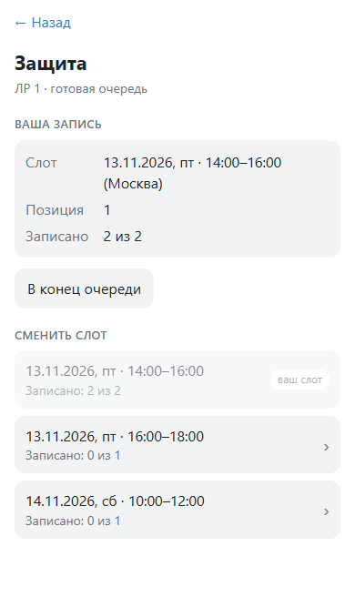

# LabDefender

Ссылка на презентацию: https://docs.google.com/presentation/d/1PQ5cNj5shg_OaYNJmu6T4IfTkAiRm_2RyPM-u-P8fvE/edit?slide=id.h39b5407bc435b763_4_109#slide=id.h39b5407bc435b763_4_109
Ссылка на промо-ролик: [https://drive.google.com/file/d/1WnEGTfSpLK4SY7IXQODULqXPcGvk84hH/view?usp=sharing](https://drive.google.com/file/d/1WnEGTfSpLK4SY7IXQODULqXPcGvk84hH/view?usp=drive_link)
Ссылка на демо-ролик: https://drive.google.com/file/d/1BC47z_RZK_1Zx3RbfWaa6awZGg8uL4ah/view?usp=sharing

Telegram-бот и Mini App для сдачи лабораторных работ и записи на защиту. Преподаватель
публикует задания, проверяет решения и открывает слоты защиты. Студент сдаёт работу,
получает результат проверки и после допуска видит её место в очереди.

## Что умеет бот

- **Преподаватель** создаёт группы со ссылками-приглашениями, публикует очные и онлайн-задания,
  допускает работы к защите или возвращает их с комментарием. Для группы он открывает
  слоты с датой, временем и лимитом мест и видит очередь каждого слота.
- **Студент** вступает в группу по ссылке, сдаёт PDF или ZIP до 20 МиБ, текст или ссылку.
  После возврата может пересдать работу. После допуска выбирает слот для работы,
  видит её позицию, может перенести запись в конец очереди или сменить слот.
- **Отчёты** показывают статусы работ и записи на защиту. Преподаватель видит сводку
  по группе и результаты студента в своих группах. Студент видит свой отчёт по всем
  группам. Отчёт можно открыть в Mini App или получить в чате как CSV через `/report`.
- **Уведомления** приходят при публикации задания, сдаче, проверке и событиях защиты.
  Преподаватель может настроить категории уведомлений.

В одном слоте защищают работы по разным заданиям одной группы. Каждая работа занимает
отдельное место. При первой записи порядок определяется временем допуска. При смене слота
работа попадает в конец новой очереди.

## Локальный запуск

Нужен Python 3.11+ и токен бота от [@BotFather](https://t.me/BotFather).
Команды выполняются из корня клонированного репозитория.

**Windows (PowerShell)**

```powershell
.\scripts\setup.ps1
```

**macOS и Linux**

```sh
sh scripts/setup.sh
```

Скрипт создаёт виртуальное окружение и файл `.env` в корне проекта. Впишите в него
`BOT_TOKEN` и задайте `TEACHER_REGISTRATION_CODE` для регистрации преподавателя.

Если используете SQLite-базу из `v0.1.0`, перед запуском остановите старого бота
и примените миграцию. Она сохраняет слоты, записи и их порядок и создаёт резервную
копию. [Инструкция по миграции](docs/local-run.md#миграция-старой-демобазы).

Запустите бота через `.\scripts\run.ps1` на Windows или `sh scripts/run.sh` на
macOS и Linux. Откройте бота в Telegram и отправьте `/start`. Для роли преподавателя
отправьте `/teacher` и введите код. Для демонстрации обеих ролей понадобятся два
аккаунта Telegram. Один токен используется одним процессом polling.

### Mini App

Установите `cloudflared` и запустите `.\scripts\run.ps1 -Tunnel` на Windows
или `sh scripts/run.sh --tunnel` на macOS и Linux. После запуска в боте появится
кнопка «Приложение». Из Mini App доступны группы, задания, проверка, очередь и отчёты.
Приглашения открываются через чат, загрузка PDF и ZIP тоже проходит через чат.
[Настройка HTTPS-адреса](docs/local-run.md#mini-app-через-временный-туннель).

## Сценарий для демонстрации

1. Преподаватель создаёт группу, отправляет студенту приглашение и публикует задание.
2. Студент вступает в группу, открывает задание и отправляет решение.
3. Преподаватель открывает «На проверку» и допускает работу к защите.
4. Преподаватель создаёт слот для группы. Студент открывает «Защита и очередь»,
   выбирает допущенную работу и записывает её на слот. Оба видят позицию записи.
5. Преподаватель открывает «Отчёты», выбирает группу и отправляет себе CSV в чат.
   Студент открывает «Мой отчёт» и видит статус работы и запись на защиту.



## Устройство проекта

Python, aiogram 3, SQLAlchemy 2 и SQLite. Бот получает обновления через polling.
Mini App использует HTTP API на aiohttp и те же сервисы, что и чат. Роли, задания,
решения и очередь хранятся в SQLite. FSM хранит шаги текущего диалога.
PDF и ZIP хранятся в Telegram, в базе сохраняется их `file_id`.

- [Сценарии ядра](docs/core-scenarios.md) описывают права, переходы, очередь и отчёты.
- [Устройство и контракты модулей](docs/integration.md) описывают сервисы, БД и API.
- [Запуск и подготовка демо](docs/local-run.md) включает диагностику, демобазу,
  миграцию и перенос на резервный компьютер.

## Проверки

Установите dev-зависимости через `.\scripts\setup.ps1 -Dev` или
`sh scripts/setup.sh --dev`. В активированном виртуальном окружении выполните:

```sh
python -m ruff check .
python -m ruff format --check .
python -m pytest -q
```

GitHub Actions запускает обе проверки Ruff на pull request и при обновлении `main`.
