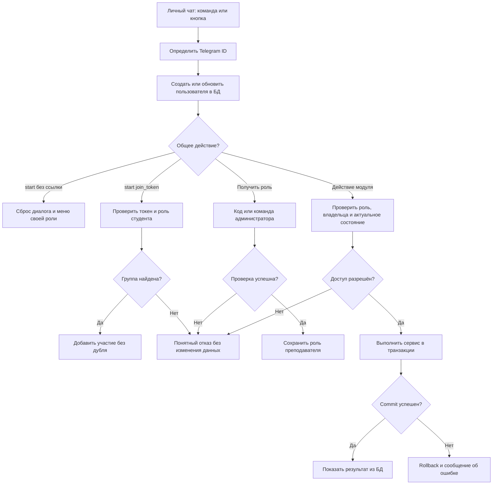
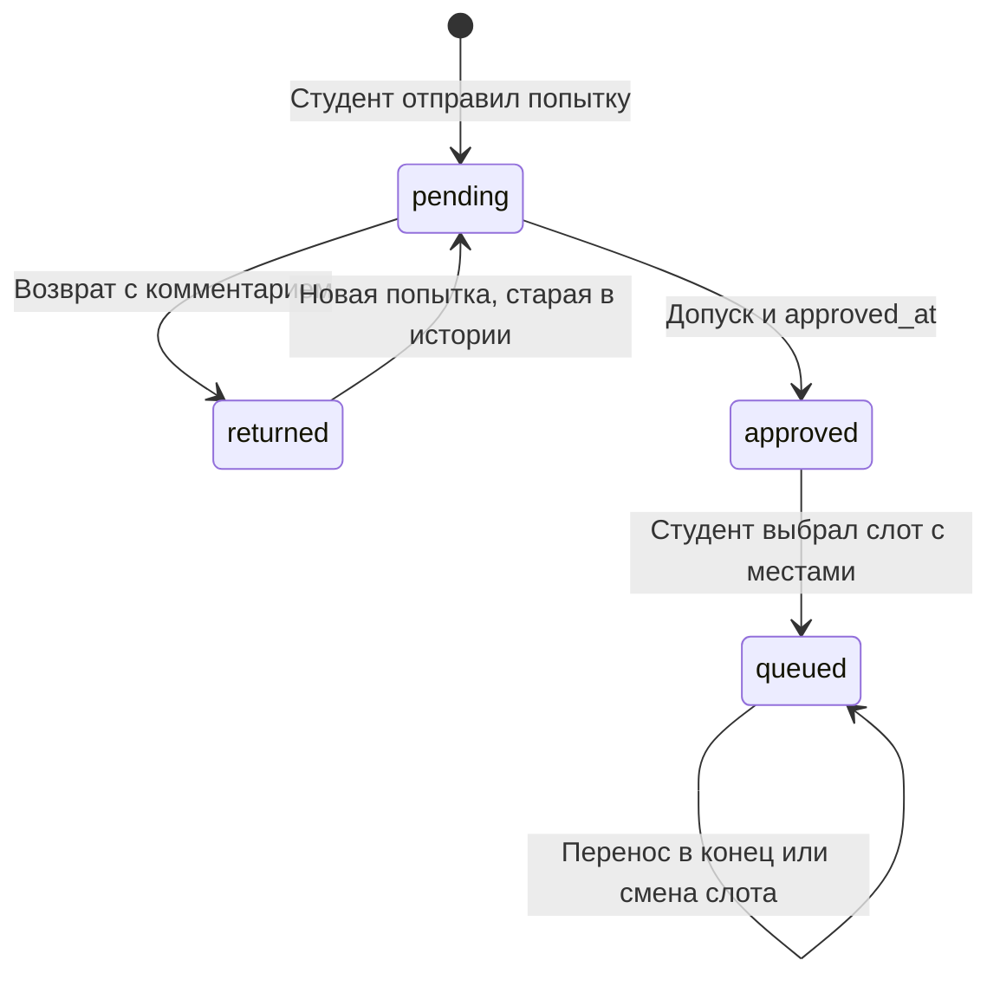

# Сценарии ядра LabDefender

Документ для команды. Ядро связывает модули студента и преподавателя: запускает
бота, хранит общие данные, определяет пользователя и его права, выдаёт приглашения
и обеспечивает согласованность решений и очереди.

Структура сценариев повторяет подход
[«Сценариев для преподавателя»](https://docs.google.com/document/d/151MQDJEMz58VQ36dY4FUjPI2ahNahVBBPHX2veqxhno/edit):
цель → действия → результат. Для ядра дополнительно указаны проверки и границы модулей.
Это описание целевого MVP; состояние реализации указано в [README](../README.md).

## Рабочие допущения для ревью

- Пользователь имеет одну роль: студент или преподаватель. По первому обращению
  создаётся студент; повышение до преподавателя требует кода или действия администратора.
  Преподаватель в этом MVP не сдаёт работы как студент.
- Администратор — Telegram ID из настроек, а не третья роль. Права преподавателя
  не дают права назначать других преподавателей.
- У группы один преподаватель. Студент может состоять в нескольких группах.
- Слот защиты относится к конкретному заданию. Дата и время выбираются кнопками
  (календарь, сетка времени) или вводятся текстом и показываются в часовом поясе
  команды `Europe/Moscow`; моменты событий хранятся в UTC.
- Студент выбирает слот **после допуска**. Это соответствует пункту 8 MVP,
  хотя во вводном описании выбор слота упоминается до проверки.
- Очередь сортируется по времени допуска. В примере преподавателя указано
  «по порядку записи» — здесь приоритет отдан явной договорённости из сообщения.
  При переносе в конец меняется ключ порядка, время допуска остаётся прежним.
- Один студент защищает одно задание один раз. Перенос в конец — внутри выбранного
  слота; смена слота — отдельная атомарная операция с проверкой свободных мест.
- Решение — один PDF, один ZIP, один текст или одна ссылка. Техническую границу
  фиксируем как 20 × 1024 × 1024 байт; файлы больше лимита или с неизвестным размером
  не принимаем. Содержимое файлов сервер не скачивает.

Эти уточнения нужны для единой реализации. Особенно стоит проверить область слота
защиты и порядок очереди до начала модулей; модели первого шага уже отражают их.

## 1. Запуск бота

**Сценарий направлен на:** одинаковый локальный запуск у каждого разработчика.

**Действия:** разработчик устанавливает зависимости, копирует `.env.example` в
`.env`, задаёт токен и выполняет `python -m labdefender` из корня проекта.

**Что должно получиться:** создаются папка данных и недостающие таблицы, подключаются
общий, студенческий и преподавательский роутеры, начинается polling.

**Проверки:** отсутствующий или некорректный токен останавливает запуск с понятным
сообщением; токен не выводится. Повторный запуск сохраняет данные. Один токен
используется только одним процессом polling. При остановке закрываются HTTP-сессия
и соединения БД. `create_all` не обновляет существующие столбцы — изменения схемы
применяем отдельно и согласованно.

## 2. Первый и повторный вход

**Сценарий направлен на:** узнавание пользователя независимо от его username.

**Действия:** пользователь открывает личный чат с ботом и отправляет `/start`.

**Что должно получиться:** создаётся пользователь с уникальным Telegram ID и ролью
студента. При повторном входе обновляются имя и username, сохраняются роль,
участие в группах, попытки и очередь. Два одновременных обращения не создают дубликат.

**Проверки:** username может отсутствовать или измениться. `/start` сбрасывает
только текущий диалог. В целевом интерфейсе показываются кнопки «Студент» и
«Я преподаватель»: выбор студента открывает его меню, выбор преподавателя
начинает проверку кода. Сам выбор кнопки прав не выдаёт.

## 3. Получение роли преподавателя по коду

**Сценарий направлен на:** доступ преподавателя без открытой саморегистрации.

**Действия:** пользователь выбирает «Я преподаватель», вводит секретный код.

**Что должно получиться:** после проверки кода из настроек в БД сохраняется роль
преподавателя и открывается его меню. Повторное подтверждение не создаёт пользователя
заново. Пустой или неверный код не меняет роль.

**Проверки:** код не хранится в callback, логах или истории БД. Ввести код можно
только в личном чате; сообщение с ним удаляем по возможности. Сравнение выполняется
без раскрытия значения. Если код не настроен, регистрация по коду закрыта,
остается ручное назначение. Ограничиваем попытки, например 5 неверных вводов за
10 минут на Telegram ID; счётчик и блокировка переживают перезапуск.
Код подтверждает знание секрета, поэтому его передают только преподавателям.

**Граница:** этот диалог, настройки и сервис смены роли принадлежат ядру.

## 4. Ручное назначение преподавателя

**Сценарий направлен на:** выдачу роли, когда общий код использовать неудобно.

**Действия:** администратор из `ADMIN_IDS` отправляет
`/grant_teacher <telegram_id>` в личном чате.

**Что должно получиться:** существующий пользователь получает роль преподавателя;
повторная команда сообщает, что роль уже выдана. Для неизвестного Telegram ID
бот просит сначала выполнить `/start`, не создавая фиктивную запись.

**Проверки:** обычный пользователь и преподаватель получают отказ. Неверный формат
команды не меняет данные. Проверяется ID отправителя из Telegram, а не имя,
username или содержимое команды. Уведомление назначенному пользователю — опция;
его недоступность не отменяет сохранённую роль.

## 5. Создание группы и получение приглашения

**Сценарий направлен на:** выдачу ссылки именно на группу нужного преподавателя.

**Действия:** преподаватель через `/create_group` вводит название и подтверждает
создание; через `/invite` выбирает свою группу.

**Что должно получиться:** у группы сохраняются владелец и случайный уникальный
токен. Ядро формирует ссылку вида `https://t.me/<bot_username>?start=join_<token>`.
Повторное получение ссылки использует сохранённый токен.

**Проверки:** пустое название и название длиннее 128 символов не принимаются;
студент не может создать группу. Получить приглашение к чужой группе нельзя,
даже подставив её ID в callback. При совпадении случайных токенов генерацию повторяем.
В ссылке нет кода преподавателя. Токен — URL-safe строка длиной 32 символа;
с префиксом `join_` payload укладывается в 64 символа.

**Граница:** модуль преподавателя ведёт диалог и рисует кнопки; общий сервис ядра
создаёт группу, проверяет владельца и возвращает ссылку.

## 6. Вход студента по приглашению

**Сценарий направлен на:** присоединение без ручного поиска группы.

**Действия:** студент открывает ссылку и нажимает Start в Telegram.

**Что должно получиться:** ядро разбирает payload, находит группу по токену,
создаёт пользователя при необходимости и сохраняет участие. Показываются название
группы и переход к заданиям. Повторное открытие сообщает «Вы уже в группе».

**Проверки:** неверная, пустая или неизвестная ссылка не добавляет участие;
преподаватель не присоединяется как студент. Пара `(group_id, student_id)` уникальна.
Пользователь может вступить в другую группу, сохранив предыдущую.
Начальный `/start join_...` полностью обрабатывает ядро, модуль студента
не дублирует обработчик `/start`.

## 7. Проверка прав на каждом действии

**Сценарий направлен на:** защиту чужих данных при повторных или поддельных кнопках.

**Действия:** пользователь вызывает команду или нажимает кнопку с ID группы,
задания, попытки либо слота защиты.

**Что должно получиться:** роль берётся из БД для текущего update, затем проверяется
связь с объектом. Преподаватель работает только со своими группами и их заданиями;
студент — с заданиями своих групп и собственными попытками/записями.

**Проверки:** скрытой кнопки недостаточно — ту же проверку выполняет сервис перед
чтением и записью. `RoleFilter` отсеивает другую роль, но не заменяет проверку
владельца. ID в callback — только указатель, а не доказательство доступа.
Открытие чужой попытки не должно отправить её файл даже до отказа.

## 8. Сохранение и пересдача решения

**Сценарий направлен на:** единый формат данных для обоих модулей.

**Действия:** студент выбирает задание, отправляет один из поддерживаемых типов
решения и подтверждает отправку.

**Что должно получиться:** сохраняется новая попытка со статусом `pending`.
Для PDF/ZIP храним `file_id`, для текста/ссылки — `content`. При возврате старая
попытка остаётся в истории; пересдача создаёт следующую с новым номером.

**Проверки:** нужны участие в группе и существующее задание; размер и тип документа
проверяются до сохранения. Новая попытка разрешена после `returned`; при `pending`
или `approved` повторная отправка отклоняется. Повторное подтверждение одного
диалога не создаёт дубль. Ограничение номера попытки и проверка последнего статуса
работают в одной транзакции. Файл по `file_id` показывает модуль преподавателя.

**Граница:** общий сервис сдачи один для обоих участников команды;
студенческий обработчик собирает ввод, преподавательский читает результат.

## 9. Возврат или допуск

**Сценарий направлен на:** согласованный статус, который сразу виден студенту.

**Действия:** владелец группы открывает актуальную попытку и выбирает «На доработку»
с непустым комментарием или «Допустить».

**Что должно получиться:** `pending → returned` либо `pending → approved`.
При допуске один раз сохраняется `approved_at` в UTC. Студент может выбрать слот
только после сохранения допуска. Студент получает уведомление о решении
(сценарий 13): о допуске — с переходом к слотам, о возврате — с комментарием.

**Проверки:** повторное нажатие и старая кнопка не переписывают финальное решение
и время допуска. Проверка статуса и запись атомарны. Нельзя проверить чужую группу
или старую попытку после пересдачи. Ошибка отправки уведомления не откатывает допуск.

## 10. Запись на слот и позиция

**Сценарий направлен на:** единую очередь для студента и преподавателя.

**Действия:** допущенный студент выбирает открытый слот своего задания.

**Что должно получиться:** при наличии места создаётся одна запись. Начальный
`order_at` равен `approved_at`; порядок — `(order_at, id)`, позиция считается при
чтении и не хранится отдельным числом. Преподаватель видит тот же порядок и заполненность.

**Проверки:** слот должен относиться к заданию попытки; прошедшие слоты недоступны.
На задание у студента одна активная запись. Повторный callback не занимает ещё одно
место. Проверка допуска, числа занятых мест и вставка — одна транзакция с блокировкой
записи SQLite (`BEGIN IMMEDIATE` до чтения доступности). При двух заявках на последнее
место проходит одна. Один лишь `COUNT`, а затем независимый `INSERT` этого не обеспечивает.

## 11. Перенос в конец и смена слота

**Сценарий направлен на:** изменение своей записи без ручной перестановки преподавателем.

**Действия:** студент подтверждает «В конец очереди» либо выбирает другой слот.

**Что должно получиться:** в первом случае сохраняется новое `order_at` после
текущих записей; `approved_at` не меняется. Во втором случае проверяется новое место
и существующая запись перемещается в конец нового слота в одной транзакции.

**Проверки:** при заполненном новом дне прежняя запись сохраняется. Нельзя менять
чужую запись, попасть на слот другого задания или занять два места. Повтор доставки
того же подтверждения не должен заново менять порядок. Если временные метки совпали,
сервис обеспечивает ключ строго после хвоста, а не полагается только на ID.

## 12. Отмена ввода, устаревшие кнопки и рестарт

**Сценарий направлен на:** восстановление работы без потери подтверждённых данных.

**Действия:** пользователь отправляет `/cancel`, нажимает старую кнопку или
возвращается после перезапуска.

**Что должно получиться:** `/cancel` очищает только FSM; сохранённые данные остаются.
Неизвестная кнопка получает ответ с предложением открыть меню. После рестарта
пользователь запускает незаконченный диалог заново; роль, группы, попытки и очередь
восстанавливаются из БД.

**Проверки:** во временном хранилище допустимы только текущий шаг, черновик и
выбранные ID. Даже ID из FSM проверяются сервисом заново. Успех показывается после
успешного commit. Исключение до commit откатывает операцию; повтор команды безопасен.

## 13. Уведомления второй стороне

**Сценарий направлен на:** понимание, что действие «доехало», без ручной проверки карточек.

**Действия:** участник выполняет действие, важное для другой стороны: студент сдаёт
решение, вступает в группу, записывается на слот или меняет его; преподаватель
публикует задание, допускает или возвращает работу, создаёт или снова открывает слот.

**Что должно получиться:** после commit бот отправляет уведомление с кнопкой
перехода к карточке. Студенту — новое задание (всем студентам группы), допуск,
возврат с полным комментарием, новый или снова открытый слот (допущенным без записи,
при наличии мест). Преподавателю — новое решение, первое вступление в группу,
запись и смена слота. Студент отключить уведомления не может; преподаватель
выключает и включает каждую категорию через `/notifications` или кнопкой
«🔕 Не присылать такие» под уведомлением. Отсутствие настройки — всё включено.

**Проверки:** автор действия не получает уведомление о нём. Повтор, который ничего
не меняет, — старая кнопка допуска, повторное открытие открытого слота, повторное
вступление по ссылке, повторная запись в тот же слот — уведомления не повторяет.
Перенос в конец очереди не уведомляет. Ошибка подготовки или доставки (бот
заблокирован, сеть, лимит Telegram) пишется в лог и не откатывает и не скрывает
действие; остальные получатели получают своё. Уведомление ставится в отправку до
ответа автору действия, поэтому сбой этого ответа не теряет уведомление. Работающий
бот рассылает в фоне, остановка ждёт начатую рассылку до 10 секунд; после рестарта
неотправленное не повторяется. Кнопки в уведомлении — обычные callback: права
и актуальность проверяются при нажатии. Отключить категорию может только
преподаватель, и только у себя.

**Граница:** доставку (`Notifier`), тексты и `/notifications` держит ядро
(`handlers/notifications.py`); ролевые обработчики вызывают готовые `notify_*`
после успешного сервиса. Сервисы бизнес-операций о Telegram и уведомлениях не знают.

## Алгоритм работы ядра

`queued` на графе обозначает наличие `QueueEntry`, а не дополнительный статус
попытки: в БД она остаётся `approved`.
