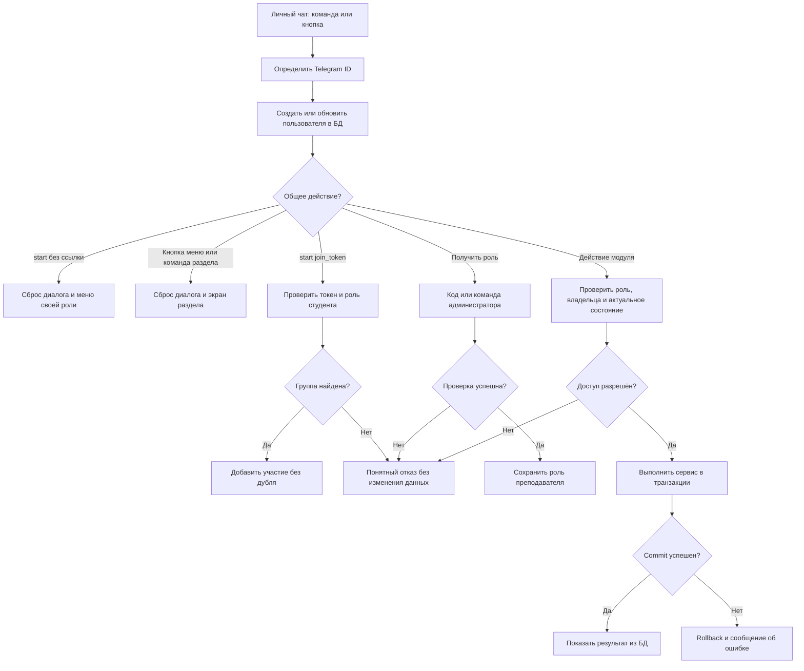
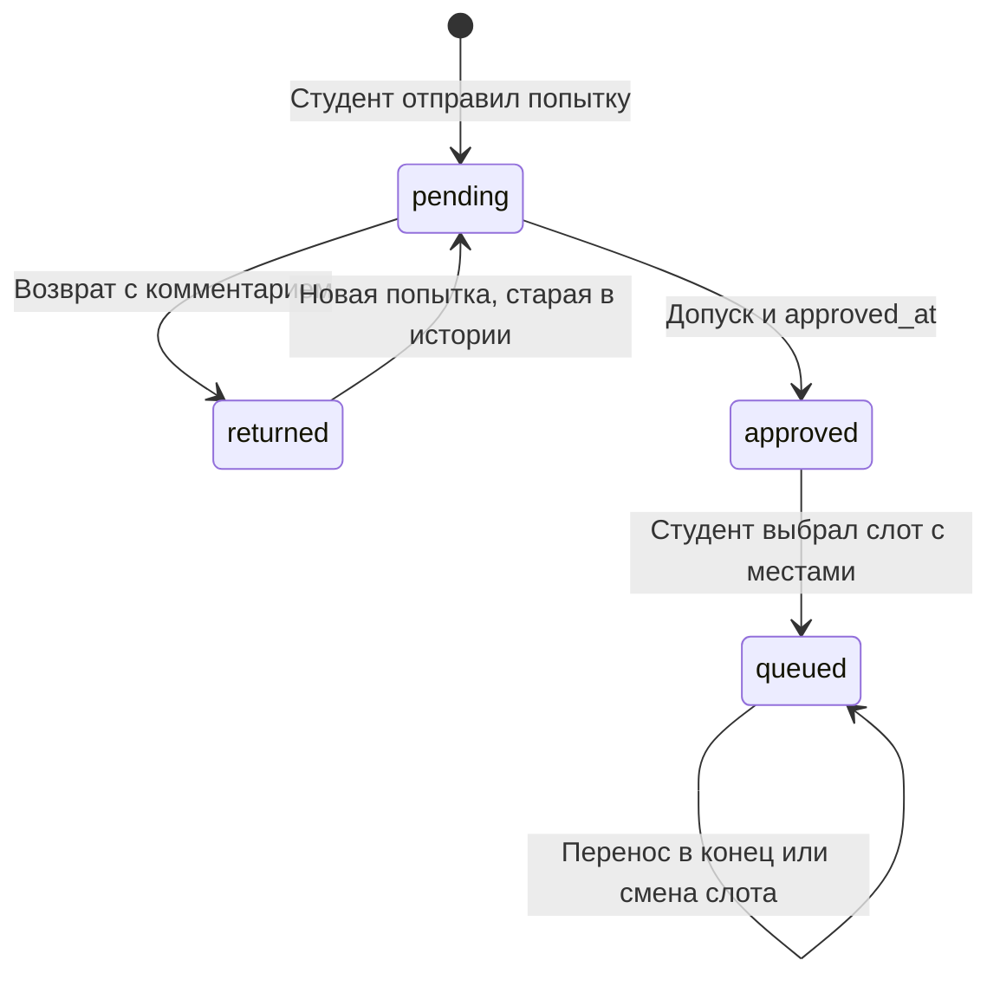

# Сценарии ядра LabDefender

Ядро связывает модули студента и преподавателя. Оно запускает бота, определяет
пользователя и его права, выдаёт приглашения и сохраняет решения и записи на защиту.
Каждый сценарий описывает действия, ожидаемый результат, проверки и границы модулей.

## Правила работы

- Пользователь имеет одну роль: студент или преподаватель. По первому обращению
  создаётся студент; повышение до преподавателя требует кода или действия администратора.
  Сдача работ доступна роли студента.
- Администратор — Telegram ID из настроек, а не третья роль. Права преподавателя
  не дают права назначать других преподавателей.
- У группы один преподаватель. Студент может состоять в нескольких группах.
- Слот защиты относится к конкретному заданию. Дата и время выбираются кнопками
  (календарь, сетка времени) или вводятся текстом и показываются в часовом поясе
  команды `Europe/Moscow`; моменты событий хранятся в UTC.
- Студент выбирает слот **после допуска**.
- При первой записи порядок определяется временем допуска. Перенос в конец меняет
  ключ порядка и сохраняет время допуска.
- Один студент защищает одно задание один раз. Перенос в конец — внутри выбранного
  слота; смена слота — отдельная атомарная операция с проверкой свободных мест.
- Всё управление — кнопками: разделы в постоянном меню роли под полем ввода, действия
  под сообщениями бота. Каждой кнопке меню соответствует команда, команды остаются.
  Текстом вводится только содержимое: названия, условие, решение, комментарий, код, ID.
- Mini App работает через API того же процесса и использует те же сервисы, что и чат.
  Файлы и уведомления обрабатываются в чате.
- Решение — один PDF, один ZIP, один текст или одна ссылка. Техническую границу
  фиксируем как 20 × 1024 × 1024 байт; файлы больше лимита или с неизвестным размером
  не принимаем. Содержимое файлов сервер не скачивает.

## 1. Запуск бота

**Сценарий направлен на:** одинаковый локальный запуск у каждого разработчика.

**Действия:** разработчик устанавливает зависимости, копирует `.env.example` в
`.env`, задаёт токен и выполняет `python -m labdefender` из корня проекта.

**Что должно получиться:** создаются папка данных и недостающие таблицы, подключаются
общий, студенческий и преподавательский роутеры, начинается polling.

**Проверки:** отсутствующий или некорректный токен останавливает запуск с понятным
сообщением; токен не выводится. Повторный запуск сохраняет данные. Один токен
используется только одним процессом polling. При остановке закрываются HTTP-сессия
и соединения БД. `create_all` не обновляет существующие столбцы — изменения схемы
применяем отдельно и согласованно.

## 2. Первый и повторный вход

**Сценарий направлен на:** узнавание пользователя независимо от его username.

**Действия:** пользователь открывает личный чат с ботом и отправляет `/start`.

**Что должно получиться:** создаётся пользователь с уникальным Telegram ID и ролью
студента. При повторном входе обновляются имя и username (имя — только если
пользователь не задал своё, см. сценарий 21), сохраняются роль, участие в группах,
попытки и очередь. Два одновременных обращения не создают дубликат.

**Проверки:** username может отсутствовать или измениться. `/start` сбрасывает
только текущий диалог и присылает постоянное меню роли (см. сценарий 14). Студенту
в приветствии подсказано, где кнопка «🎓 Я преподаватель» («❓ Помощь»); она начинает
проверку кода. Сама кнопка прав не выдаёт.

## 3. Получение роли преподавателя по коду

**Сценарий направлен на:** доступ преподавателя без открытой саморегистрации.

**Действия:** пользователь нажимает «❓ Помощь» → «🎓 Я преподаватель» (или `/teacher`),
вводит секретный код.

**Что должно получиться:** после проверки кода из настроек в БД сохраняется роль
преподавателя и приходит меню преподавателя. Повторное подтверждение не создаёт пользователя
заново. Пустой или неверный код не меняет роль.

**Проверки:** код не хранится в callback, логах или истории БД. Ввести код можно
только в личном чате; сообщение с ним удаляем по возможности. Сравнение выполняется
без раскрытия значения. Если код не настроен, регистрация по коду закрыта,
остается ручное назначение. Ограничиваем попытки, например 5 неверных вводов за
10 минут на Telegram ID; счётчик и блокировка переживают перезапуск.
Код подтверждает знание секрета, поэтому его передают только преподавателям.

**Граница:** этот диалог, настройки и сервис смены роли принадлежат ядру.

## 4. Ручное назначение преподавателя

**Сценарий направлен на:** выдачу роли, когда общий код использовать неудобно.

**Действия:** администратор из `ADMIN_IDS` в личном чате нажимает «❓ Помощь» →
«👤 Выдать роль преподавателя» (или `/grant_teacher` без аргумента) и присылает
Telegram ID текстом, либо сразу отправляет `/grant_teacher <telegram_id>`.

**Что должно получиться:** существующий пользователь получает роль преподавателя;
повторная команда сообщает, что роль уже выдана. Для неизвестного Telegram ID
бот просит сначала выполнить `/start`, не создавая фиктивную запись; в пошаговом
вводе можно сразу прислать другой ID. Старое меню назначенного пользователя
обновляется при первом нажатии его кнопки.

**Проверки:** обычный пользователь и преподаватель получают отказ. Неверный формат
команды не меняет данные. Проверяется ID отправителя из Telegram, а не имя,
username или содержимое команды. Уведомление назначенному пользователю — опция;
его недоступность не отменяет сохранённую роль.

## 5. Создание группы и получение приглашения

**Сценарий направлен на:** выдачу ссылки именно на группу нужного преподавателя.

**Действия:** преподаватель нажимает «➕ Создать группу» (в «👥 Мои группы», в помощи
или `/create_group`), вводит название и подтверждает создание; через «🔗 Пригласить»
(`/invite`) выбирает свою группу.

**Что должно получиться:** у группы сохраняются владелец и случайный уникальный
токен. Ядро формирует ссылку вида `https://t.me/<bot_username>?start=join_<token>`.
Повторное получение ссылки использует сохранённый токен.

**Проверки:** пустое название и название длиннее 128 символов не принимаются;
студент не может создать группу. Получить приглашение к чужой группе нельзя,
даже подставив её ID в callback. При совпадении случайных токенов генерацию повторяем.
В ссылке нет кода преподавателя. Токен — URL-safe строка длиной 32 символа;
с префиксом `join_` payload укладывается в 64 символа.

**Граница:** модуль преподавателя ведёт диалог и рисует кнопки; общий сервис ядра
создаёт группу, проверяет владельца и возвращает ссылку.

## 6. Вход студента по приглашению

**Сценарий направлен на:** присоединение без ручного поиска группы.

**Действия:** студент открывает ссылку и нажимает Start в Telegram.

**Что должно получиться:** ядро разбирает payload, находит группу по токену,
создаёт пользователя при необходимости и сохраняет участие. Бот присылает меню
студента вместе с «Вы присоединились к группе …», затем карточку группы с кнопками
«Задания группы» и «Защита и очередь». Повторное открытие сообщает «Вы уже в группе».

**Проверки:** неверная, пустая или неизвестная ссылка не добавляет участие;
преподаватель не присоединяется как студент. Пара `(group_id, student_id)` уникальна.
Пользователь может вступить в другую группу, сохранив предыдущую.
Начальный `/start join_...` полностью обрабатывает ядро, модуль студента
не дублирует обработчик `/start`.

## 7. Проверка прав на каждом действии

**Сценарий направлен на:** защиту чужих данных при повторных или поддельных кнопках.

**Действия:** пользователь вызывает команду или нажимает кнопку с ID группы,
задания, попытки либо слота защиты.

**Что должно получиться:** роль берётся из БД для текущего update, затем проверяется
связь с объектом. Преподаватель работает только со своими группами и их заданиями;
студент — с заданиями своих групп и собственными попытками/записями.

**Проверки:** скрытой кнопки недостаточно — ту же проверку выполняет сервис перед
чтением и записью. `RoleFilter` отсеивает другую роль, но не заменяет проверку
владельца. ID в callback — только указатель, а не доказательство доступа.
Открытие чужой попытки не должно отправить её файл даже до отказа.

## 8. Сохранение и пересдача решения

**Сценарий направлен на:** единый формат данных для обоих модулей.

**Действия:** студент выбирает задание, отправляет один из поддерживаемых типов
решения и подтверждает отправку.

**Что должно получиться:** сохраняется новая попытка со статусом `pending`.
Для PDF/ZIP храним `file_id`, для текста/ссылки — `content`. При возврате старая
попытка остаётся в истории; пересдача создаёт следующую с новым номером.

**Проверки:** нужны участие в группе и существующее задание; размер и тип документа
проверяются до сохранения. Новая попытка разрешена после `returned`; при `pending`
или `approved` повторная отправка отклоняется. Повторное подтверждение одного
диалога не создаёт дубль. Ограничение номера попытки и проверка последнего статуса
работают в одной транзакции. Файл по `file_id` показывает модуль преподавателя.

**Граница:** общий сервис сдачи один для обоих участников команды;
студенческий обработчик собирает ввод, преподавательский читает результат.

## 9. Возврат или допуск

**Сценарий направлен на:** согласованный статус, который сразу виден студенту.

**Действия:** владелец группы открывает актуальную попытку и выбирает «На доработку»
с непустым комментарием или «Допустить».

**Что должно получиться:** `pending → returned` либо `pending → approved`.
При допуске один раз сохраняется `approved_at` в UTC. Студент может выбрать слот
только после сохранения допуска. Студент получает уведомление о решении
(сценарий 13): о допуске — с переходом к слотам, о возврате — с комментарием.

**Проверки:** повторное нажатие и старая кнопка не переписывают финальное решение
и время допуска. Проверка статуса и запись атомарны. Нельзя проверить чужую группу
или старую попытку после пересдачи. Ошибка отправки уведомления не откатывает допуск.

## 10. Запись на слот и позиция

**Сценарий направлен на:** единую очередь для студента и преподавателя.

**Действия:** допущенный студент выбирает открытый слот своего задания.

**Что должно получиться:** при наличии места создаётся одна запись. Начальный
`order_at` равен `approved_at`; порядок — `(order_at, id)`, позиция считается при
чтении и не хранится отдельным числом. Преподаватель видит тот же порядок и заполненность.

**Проверки:** слот должен относиться к заданию попытки; прошедшие слоты недоступны.
На задание у студента одна активная запись. Повторный callback не занимает ещё одно
место. Проверка допуска, числа занятых мест и вставка — одна транзакция с блокировкой
записи SQLite (`BEGIN IMMEDIATE` до чтения доступности). При двух заявках на последнее
место проходит одна. Один лишь `COUNT`, а затем независимый `INSERT` этого не обеспечивает.

## 11. Перенос в конец и смена слота

**Сценарий направлен на:** изменение своей записи без ручной перестановки преподавателем.

**Действия:** студент подтверждает «В конец очереди» либо выбирает другой слот.

**Что должно получиться:** в первом случае сохраняется новое `order_at` после
текущих записей; `approved_at` не меняется. Во втором случае проверяется новое место
и существующая запись перемещается в конец нового слота в одной транзакции.

**Проверки:** при заполненном новом дне прежняя запись сохраняется. Нельзя менять
чужую запись, попасть на слот другого задания или занять два места. Повтор доставки
того же подтверждения не должен заново менять порядок. Если временные метки совпали,
сервис обеспечивает ключ строго после хвоста, а не полагается только на ID.

## 12. Отмена ввода, устаревшие кнопки и рестарт

**Сценарий направлен на:** восстановление работы без потери подтверждённых данных.

**Действия:** пользователь отправляет `/cancel`, нажимает «Отмена» под запросом
текста, нажимает кнопку раздела в меню, нажимает старую кнопку или возвращается
после перезапуска.

**Что должно получиться:** `/cancel` и «Отмена» очищают только FSM; сохранённые данные
остаются, приходит меню роли. Кнопка раздела тоже прерывает ввод и не считается
ответом на него. Неизвестная кнопка получает ответ с предложением открыть раздел
из меню, непонятный текст — меню роли. После рестарта
пользователь запускает незаконченный диалог заново; роль, группы, попытки и очередь
восстанавливаются из БД.

**Проверки:** во временном хранилище допустимы только текущий шаг, черновик и
выбранные ID. Даже ID из FSM проверяются сервисом заново. Успех показывается после
успешного commit. Исключение до commit откатывает операцию; повтор команды безопасен.

## 13. Уведомления второй стороне

**Сценарий направлен на:** понимание, что действие «доехало», без ручной проверки карточек.

**Действия:** участник выполняет действие, важное для другой стороны: студент сдаёт
решение, вступает в группу, записывается на слот или меняет его; преподаватель
публикует задание, допускает или возвращает работу, создаёт или снова открывает слот.

**Что должно получиться:** после commit бот отправляет уведомление с кнопкой
перехода к карточке. Студенту — новое задание (всем студентам группы), допуск,
возврат с полным комментарием, новый или снова открытый слот (допущенным без записи,
при наличии мест). Преподавателю — новое решение, первое вступление в группу,
запись и смена слота. Студент отключить уведомления не может; преподаватель
выключает и включает каждую категорию в «🔔 Уведомления» (`/notifications`) или кнопкой
«🔕 Не присылать такие» под уведомлением. Отсутствие настройки — всё включено.

**Проверки:** автор действия не получает уведомление о нём. Повтор, который ничего
не меняет, — старая кнопка допуска, повторное открытие открытого слота, повторное
вступление по ссылке, повторная запись в тот же слот — уведомления не повторяет.
Перенос в конец очереди не уведомляет. Ошибка подготовки или доставки (бот
заблокирован, сеть, лимит Telegram) пишется в лог и не откатывает и не скрывает
действие; остальные получатели получают своё. Уведомление ставится в отправку до
ответа автору действия, поэтому сбой этого ответа не теряет уведомление. Работающий
бот рассылает в фоне, остановка ждёт начатую рассылку до 10 секунд; после рестарта
неотправленное не повторяется. Кнопки в уведомлении — обычные callback: права
и актуальность проверяются при нажатии. Отключить категорию может только
преподаватель, и только у себя.

**Граница:** доставку (`Notifier`), тексты и экран настроек держит ядро
(`handlers/notifications.py`); ролевые обработчики вызывают готовые `notify_*`
после успешного сервиса. Сервисы бизнес-операций о Telegram и уведомлениях не знают.

## 14. Меню и кнопки вместо команд

**Сценарий направлен на:** работу с ботом без запоминания команд.

**Действия:** пользователь нажимает кнопки постоянного меню под полем ввода и кнопки
под сообщениями бота; при желании отправляет прежние команды.

**Что должно получиться:** у студента меню «📚 Задания», «🗓 Защита и очередь»,
«👥 Мои группы», «❓ Помощь»; у преподавателя — «📥 На проверку», «🗓 Защита и очередь»,
«📝 Новое задание», «🕒 Новый слот», «👥 Мои группы», «🔗 Пригласить», «🔔 Уведомления»,
«❓ Помощь». Каждая кнопка меню открывает тот же экран, что и её команда; помощь
перечисляет пары «кнопка — команда» и даёт кнопки для остального: Telegram ID,
уведомления студента, «Я преподаватель», «Создать группу», выдача роли администратором.
Под каждым запросом текста есть «Отмена».

**Проверки:** кнопка раздела во время ввода не становится кодом, названием или решением
и не увеличивает счётчик неверных кодов. «❓ Помощь» ввод не прерывает, как и `/help`.
Кнопка чужой роли (меню осталось после смены роли) ничего не открывает и присылает меню
текущей роли. Права проверяются так же, как у команд: меню — только навигация.

**Граница:** меню, точки входа в разделы и общая «Отмена» принадлежат ядру
(`keyboards/menu.py`, `handlers/menu.py`, `handlers/common.py`). Новый раздел модуля
добавляется кнопкой в `MenuButton`/`MENU_LAYOUT`, командой в `MENU_COMMANDS` и
обработчиком в `handlers/menu.py`; ролевые роутеры держат только свои callback и шаги ввода.

## 15. Вход в Mini App

**Сценарий направлен на:** безопасное открытие веб-интерфейса внутри Telegram.

**Действия:** пользователь нажимает кнопку «Приложение» рядом с полем ввода, кнопку
«📱 Открыть приложение» под ответом на `/app`, `/start` или под помощью, либо
«📱 Открыть в приложении» под уведомлением.

**Что должно получиться:** Telegram открывает `<WEBAPP_URL>/app/` и передаёт странице
подписанные `initData`. Страница отправляет их в каждом запросе API; сервер проверяет
подпись и возраст, находит или создаёт пользователя по Telegram ID и отвечает от его
имени. Главный экран показывает имя, роль и разделы. Кнопка под уведомлением сразу
открывает экран того же объекта (`?screen=…`), «Назад» ведёт к его списку.

**Проверки:** без `initData`, с чужой или испорченной подписью, без пользователя или со
слишком старыми (`WEBAPP_AUTH_MAX_AGE`) данными API отвечает 401 и ничего не создаёт.
ID из тела или адреса запроса не принимается. Права в разделах проверяют
те же сервисы, что и в чате. Без `WEBAPP_URL` веб-сервер не запускается, а кнопка
возвращается к списку команд. Временный адрес меняется при каждом запуске.

**Граница:** веб-сервер, авторизация и кнопка принадлежат ядру (`web/`, `tunnel.py`);
разделы Mini App используют общие сервисы.

## 16. Слоты защиты в Mini App

**Сценарий направлен на:** удобное создание слотов и работу с очередью без длинного
диалога в чате.

**Действия:** преподаватель открывает «🗓 Слоты и очередь», выбирает группу и задание,
нажимает «Новый слот», выбирает дату в календаре, начало, длительность, число мест
(или «Как в прошлый раз», или своё время) и подтверждает. В очереди слота закрывает,
снова открывает или отменяет пустой слот.

**Что должно получиться:** результат тот же, что у мастера в чате: слот сохранён,
допущенные студенты без записи получили уведомление, открывается очередь слота.
В списке слотов видны заполненность и пометки «мест нет», «закрыт», «прошёл»,
а ниже — допущенные студенты без записи.

**Проверки:** календарь и свободное время считает сервер по московскому времени теми же
правилами (`services/slot_grid.py`); занятое и прошедшее время не предлагается, а прямой
запрос с пересечением или прошедшей датой отклоняется с текстом из чата. Двойное
нажатие или повтор после потерянного ответа с тем же `Idempotency-Key` не создают слот
и уведомления повторно. Повторное «Открыть» уведомляет только при реальном открытии.
Студенту операции со слотами запрещены (403), чужой преподаватель слот не видит (404).

**Граница:** API — `web/api/defense.py`, экраны — `web/static/views/slots.js` и
`new-slot.js`; запись и проверки — `services/queue.py`.

## 17. Студент в Mini App: задания, сдача, защита

**Сценарий направлен на:** работу студента с заданиями и очередью без переписки в чате.

**Действия:** студент открывает «📚 Задания», выбирает группу и задание, отвечает текстом
или ссылкой либо нажимает «Отправить файл PDF/ZIP через чат», смотрит попытки и
комментарий. После допуска в «🗓 Защита и очередь» записывается на слот, меняет его
или переносит запись в конец.

**Что должно получиться:** результат тот же, что в чате: новая попытка «На проверке»,
преподаватель получает уведомление; запись и позиция в очереди сохраняются, преподаватель
узнаёт о записи и смене слота. Файл сдаётся в чате: кнопка ставит тот же шаг ввода,
бот пишет в чат, дальше — обычное подтверждение.

**Проверки:** сдача закрыта, пока последняя попытка на проверке или допущена; ответ
сравнивается с ожидаемой предыдущей попыткой; двойное нажатие не создаёт вторую попытку.
Запись проверяет показанную версию: изменение в другом месте даёт отказ с просьбой
обновить экран. До допуска защита закрыта. Если бот не может написать в чат, шаг ввода
снимается и показывается понятная ошибка. Студент видит только свои попытки.

**Граница:** `web/api/courses.py`, `web/api/submissions.py`, `web/api/defense.py`,
экраны `views/student.js` и `views/attempt.js`; сервисы те же, что у чата.

## 18. Преподаватель в Mini App: проверка, группы, задания

**Сценарий направлен на:** быструю проверку и публикацию без поиска по группам.

**Действия:** преподаватель открывает «📥 На проверку», допускает или возвращает
с комментарием, при необходимости просит бота прислать файл в чат. В «👥 Группы»
создаёт группу и делится ссылкой-приглашением; в «📝 Задания» публикует задание
и смотрит попытки студентов.

**Что должно получиться:** в очереди проверки — ожидающие попытки всех его групп,
давние первыми; решение сохраняется и уведомляет студента, как в чате. Группа и задание
создаются один раз даже при двойном нажатии; студенты группы получают уведомление
о новом задании.

**Проверки:** чужие группы, задания и попытки недоступны (404), студенту действия
преподавателя запрещены (403). Повторный допуск или возврат — 409 без второго
уведомления. Комментарий к возврату обязателен. Файл не скачивается сервером:
бот присылает его по `file_id` в чат нажавшего.

**Граница:** `web/api/courses.py`, `web/api/submissions.py`, экраны `views/teacher.js`
и `views/attempt.js`; `services.submissions.list_pending_reviews`,
`services.groups.count_members`.

## 19. Профиль, роль и уведомления в Mini App

**Сценарий направлен на:** всё, что ещё оставалось только в чате: свой Telegram ID,
код преподавателя, выдачу роли и настройки уведомлений.

**Действия:** пользователь открывает «👤 Профиль» и копирует Telegram ID. Студент
нажимает «🎓 Я преподаватель» и вводит код. Администратор из `ADMIN_IDS` открывает
«👤 Выдать роль преподавателя» и вводит Telegram ID. Преподаватель в «🔔 Уведомления»
включает и выключает категории или все сразу.

**Что должно получиться:** верный код делает студента преподавателем: приложение
сразу показывает разделы преподавателя, а бот присылает в чат меню преподавателя
и сбрасывает незаконченный ввод студента. Выдача роли и настройки уведомлений дают тот же
результат, что в чате, и видны там же.

**Проверки:** код вводится скрыто, не возвращается сервером и не попадает в логи;
лимит — те же 5 неверных попыток за 10 минут с общим с чатом счётчиком (429 при
блокировке), при отключённой регистрации вход к коду не показывается, а прямой запрос
отклоняется. Выдать роль может только администратор (403), неизвестному ID — отказ
с просьбой сначала открыть бота; повтор сообщает, что роль уже есть. Студенту
настройки уведомлений недоступны (403): его уведомления не отключаются.

**Граница:** `web/api/profile.py`, `web/api/notifications.py`, экраны `views/profile.js`;
сервисы `services.auth` и `services.notifications`, как у чата.

## 20. Постоянный адрес, перезапуск и резервный ноутбук

**Сценарий направлен на:** работу Mini App на демо так же надёжно, как бота в чате.

**Действия:** команда один раз создаёт в Cloudflare туннель для адреса на своём домене,
записывает в `.env` `WEBAPP_URL` и `TUNNEL_TOKEN` на основном и резервном ноутбуке
и запускает бота с `--tunnel`. Для перехода на резерв основной запуск останавливают,
а резервный запускают тем же способом с копией базы.

**Что должно получиться:** адрес не меняется между перезапусками и ноутбуками, поэтому
кнопки «Приложение», `/app`, `/start` и кнопки под старыми уведомлениями продолжают
работать. После старта бот сам открывает `<WEBAPP_URL>/health` через интернет
и пишет в консоль, открывается ли адрес.

**Проверки:** токен передаётся `cloudflared` через переменную окружения и не печатается.
Неверный токен или нет сети — запуск останавливается с подсказкой и сообщением
`cloudflared`. Если по адресу отвечает другой запуск (резерв не остановлен), бот
предупреждает в консоли: два запуска делят адрес, и запросы попадают в разные базы.
Пока бот остановлен, уже открытое приложение на действия отвечает «Сервер недоступен»
(ответ туннеля без JSON с кодом 5xx), новое открытие показывает страницу Cloudflare;
после запуска «Повторить» работает снова.

**Без своего домена:** временный туннель держит отдельное окно (`scripts/tunnel.sh`),
бот с `--tunnel` берёт его адрес. Перезапуск бота адрес не меняет; перезапуск окна
туннеля, ноутбука или переход на резерв даёт новый адрес — участники отправляют
`/start`, кнопки приложения в старых уведомлениях перестают работать, кнопки чата
работают.

**Граница:** `tunnel.py`, `__main__.py`, `tools.py` (`tunnel`), `web/reachability.py`;
настройка Cloudflare и порядок демо — в `docs/local-run.md`.

## 21. Своё имя и список студентов группы

**Сценарий направлен на:** узнаваемые имена, когда имя в Telegram не совпадает
с настоящим, и быстрый взгляд преподавателя на состав группы.

**Действия:** пользователь задаёт имя и фамилию: в чате «✏️ Моё имя» (`/name`),
в приложении «👤 Профиль» → имя. Преподаватель в карточке группы приложения
открывает «👥 Посмотреть студентов».

**Что должно получиться:** новое имя видно везде — в списке студентов, попытках,
очереди, уведомлениях; следующие обращения из Telegram его не перезаписывают.
«Вернуть имя из Telegram» возвращает обычное поведение. Список студентов — имя
и `@username` каждого студента группы по алфавиту, страницами по восемь.

**Проверки:** имя от 1 до 128 символов после схлопывания пробелов; неверное отклоняется
без изменений, в чате шаг сохраняется. Кнопка раздела во время ввода имени прерывает
ввод и именем не становится. Чужое имя изменить нельзя: сервис берёт только действующего
пользователя. Список студентов видит только преподаватель группы (студенту 403, чужому
преподавателю 404). Username не редактируется и подтверждает, кто есть кто.

**Граница:** `services/users.py`, `services/groups.list_members`, таблица `user_profiles`;
`handlers/registration.py`, `web/api/profile.py`, `web/api/courses.py`, экраны
`views/profile.js` и `views/teacher.js`.

## Алгоритм работы ядра

`queued` на графе обозначает наличие `QueueEntry`, а не дополнительный статус
попытки: в БД она остаётся `approved`.
