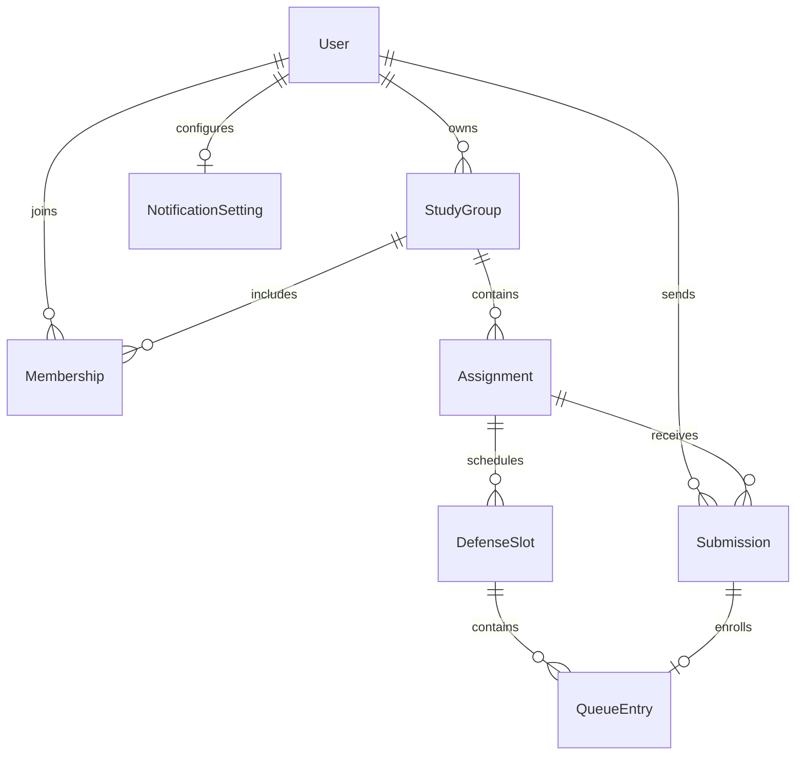

# Подключение модулей

## Что уже доступно

- `labdefender.app.create_dispatcher(session_factory, settings=settings, notifier=...)`
  подключает общий роутер с регистрацией, затем студента, преподавателя, роутер
  уведомлений и последним fallback. Без `settings` фабрика тоже работает, но регистрация
  по коду и админ-доступ отключены — это удобно для изолированных тестов. Без `notifier`
  уведомления отправляются сразу внутри обработчика (детерминированно для тестов);
  `run()` передаёт `Notifier(background=True, delay=0.05)`.
- Обработчики работают в личном чате. Групповые сообщения и inline-mode callbacks
  не входят в MVP.
- Аргументы обработчика `session: AsyncSession` и `current_user: User` заполняются
  middleware для сообщений и callback. Каждому update соответствует своя сессия.
- `current_user.id` — внутренний PK. `current_user.telegram_id` — ID Telegram;
  внешние ключи моделей ссылаются именно на внутренний PK.
- `RoleFilter` подключён к `message` и `callback_query` каждого ролевого роутера.
- `/my_groups` работает для обеих ролей; `/create_group` и `/invite` — у преподавателя.
  Общий `/start join_<token>` регистрирует участие студента, включая первый вход.
- `/new_assignment` и `/submissions` работают у преподавателя, `/assignments` —
  у студента. Кнопки заданий и проверки уже подключены к карточкам групп.
- `/new_slot` создаёт слот защиты для задания через мастер с кнопками (календарь,
  сетка времени, длительность, места, повтор прошлого слота) или ручной текстовый ввод.
  `/queue` работает для обеих ролей, переход студента к записи также есть в карточке
  допущенного задания.
- Новая Telegram-учётка автоматически сохраняется как `student`; кнопка
  «Я преподаватель» и `/teacher` начинают проверку кода. Смена имени не сбрасывает роль.
- `TEACHER_REGISTRATION_CODE` задаётся в `.env`, `ADMIN_IDS` — JSON-массив Telegram ID.
  Админ-команда `/grant_teacher <telegram_id>` назначает роль зарегистрированному
  пользователю; админ-права не зависят от учебной роли.
- Роли: `Role.STUDENT`, `Role.TEACHER`. Статусы: `PENDING`, `RETURNED`, `APPROVED`.
  В БД сохраняются строковые значения в нижнем регистре из общих enum-ов.
- Уведомления второй стороне подключены к сдаче, проверке, публикации, вступлению,
  созданию и повторному открытию слота, записи и смене слота. `/notifications`
  работает для обеих ролей: преподаватель управляет категориями, студент видит,
  что его уведомления не отключаются. Контракт — в разделе «Уведомления».

## Где писать

У каждого ролевого модуля своя папка в `handlers/`. Кнопки и состояния кладём
в `keyboards/student.py`, `keyboards/teacher.py`, `states/student.py`,
`states/teacher.py` либо одноимённые подпапки по мере роста.

Общие файлы `app.py`, `config.py`, `enums.py`, `db/`, `middlewares/`,
`handlers/common.py`, `handlers/notifications.py`, `services/users.py`,
`services/notifications.py` меняет автор ядра. Изменения схемы сначала
согласовываем: иначе разработчики получат несовместимые локальные SQLite-базы.
Остальные сервисы закрепляем за одним человеком на этапе реализации.

Пример нового файла `handlers/student/assignments.py`:

```python
from aiogram import Router
from aiogram.filters import Command
from aiogram.types import Message
from sqlalchemy.ext.asyncio import AsyncSession

from labdefender.db.models import User


def create_router() -> Router:
    router = Router(name="student_assignments")

    @router.message(Command("assignments"))
    async def assignments(message: Message, session: AsyncSession, current_user: User) -> None:
        # Здесь вызвать общий сервис списка заданий с current_user.id.
        # Сервис должен ограничить результат группами текущего студента.
        await message.answer("Пока нет доступных заданий.")

    return router
```

В `handlers/student/__init__.py` импортируем модуль и внутри `create_router()`
перед `return router` вызываем `router.include_router(assignments.create_router())`.
У преподавателя — аналогично. Фабрики создают новые роутеры при каждом запуске,
что позволяет собирать Dispatcher в тестах. Не создаём второго Dispatcher или Bot
внутри модуля.

Сначала регистрируем точные команды и callback, затем обработчики ввода с фильтром
конкретного FSM-состояния. Общий обработчик «любое сообщение» в ролевом модуле
перехватит команды следующих роутеров. `/start`, `/help`, `/cancel` остаются общими.
Для callback используем префиксы `student:` / `teacher:` и `CallbackData`.
На обработанную callback-кнопку всегда отвечаем через `callback.answer()`.
Префикс `auth:` и `TeacherRegistration` заняты общим диалогом регистрации.
Код никогда не записываем в FSM и не включаем в сообщения или логи. Команды
`/teacher` и `/grant_teacher` также принадлежат ядру.

Групповые обработчики уже подключены в `handlers/student/groups.py` и
`handlers/teacher/groups.py`. Их не нужно повторно регистрировать в другом модуле.
Для будущих кнопок перехода к заданиям используйте ID группы из карточки и повторную
проверку доступа в сервисе; не храните «текущую группу» как единственный источник прав.
Пространства callback `student:groups:...`, `teacher:groups:...` и
`teacher:create_group:...`, а также FSM `GroupCreation` заняты модулем групп.

## Готовые сервисы групп

Функции из `services/groups.py` принимают внутренний `actor_id` пользователя:

- `create_group(session, actor_id=..., name=...) → StudyGroup` — проверяет роль
  преподавателя, нормализует название, сохраняет группу и случайный уникальный токен.
- `list_groups(session, actor_id=..., offset=0) → GroupPage` — для преподавателя
  возвращает собственные группы, для студента — группы с его участием. В результате
  есть `groups`, `offset`, `has_next`; размер страницы — `GROUP_PAGE_SIZE = 8`.
- `get_group(session, actor_id=..., group_id=...) → StudyGroup` — карточка
  с проверкой владельца или членства.
- `get_invite_link(session, actor_id=..., group_id=..., bot_username=...) → str` —
  только владелец-преподаватель может получить ссылку. Handler передаёт username
  из `bot.me()`; сам сервис не обращается в Telegram.
- `parse_invite_payload(payload) → str` — проверяет формат `join_<token>` и возвращает
  токен для `join_group(session, actor_id=..., invite_token=...) → JoinGroupResult`.
  У результата есть `group` и `joined`: `True` только при создании нового участия.

`create_group` и `join_group` сами открывают транзакцию и делают commit.
Не вызывайте их после предварительного чтения в той же сессии или внутри внешнего
transaction-блока. Методы чтения commit не делают. Вступление проверяет роль,
токен и наличие участия под одной SQLite-блокировкой; параллельные запросы
не создают второе участие.

Создание группы через интерфейс защищено от повторного подтверждения: FSM хранит
имя и случайный идентификатор текущего черновика, callback должен соответствовать
ему. После commit FSM очищается до отправки сообщений. Старая кнопка, потеря
черновика при рестарте или ошибка доставки не запускают создание повторно.
Отдельный новый вызов `create_group` создаёт новую группу: одинаковые названия
разрешены, сервис сам по себе не объединяет такие группы.

## Транзакции и права

Сервис выполняет проверку прав и состояния объекта, запись и явный `commit`;
при ошибке — `rollback`. Handler отправляет сообщение об успехе после возврата
сервиса. Middleware закрывает сессию; несохранённые изменения откатываются,
автоматического commit в конце обработчика нет.

`ensure_user` сохраняет профиль отдельно **до** ролевого обработчика; поэтому
транзакция бизнес-операции не захватывает обновление Telegram-профиля. Чтение через
SQLAlchemy само начинает транзакцию: не вызываем `session.begin()` после такого
чтения без завершения предыдущей. В критичных операциях очередь сначала берёт
блокировку, затем проверяет состояние и свободные места; реализация — этап 5.

Успешный `RoleFilter` проверяет только роль. Сервис обязан проверять владельца
группы/попытки, участие в группе и принадлежность слота заданию. Существование ID
в callback, FSM или БД само по себе прав не даёт.

Готовые проверки из `services/access.py`:

- `require_user(session, actor_id=..., role=...)` — пользователь и необязательная роль.
- `require_group_owner(session, actor_id=..., group_id=...)` — преподаватель-владелец.
- `require_group_member(session, actor_id=..., group_id=...)` — студент-участник.
- `require_assignment_access(session, actor_id=..., assignment_id=...)` — доступ
  владельца группы или её студента к заданию.
- `require_submission_access(session, actor_id=..., submission_id=...)` — преподаватель
  своей группы или автор решения, который всё ещё состоит в группе.
- `require_defense_slot_access(session, actor_id=..., slot_id=...)` — доступ
  к дню через его задание. Допуск к записи и вместимость эта проверка не проверяет.

Функции возвращают разрешённую ORM-модель или выбрасывают безопасную `DomainError`.
Они не делают commit. Отсутствующий и чужой объект получают одинаковый ответ.
Middleware показывает доменные ошибки по-русски; для callback — через alert.
Не отправляйте файл/содержимое попытки до успешного вызова проверки.

`db.transactions.immediate_transaction(session)` открывает `BEGIN IMMEDIATE`:
при успешном выходе делает commit, при исключении — rollback. Вызов должен быть
**до любых запросов** в этой сессии: проверки доступа выполняются уже внутри него.
Именно так операции регистрации и ручного назначения сериализуют проверки и запись.
Для будущих сервисов, которым нужна такая блокировка:

```python
async with immediate_transaction(session):
    group = await require_group_owner(session, actor_id=actor_id, group_id=group_id)
    # Проверить входные данные и изменить разрешённый объект.
# Успех сообщаем только после выхода из блока.
```

Ошибка неверного кода — особый случай: счётчик сначала коммитится, затем сервис
выбрасывает `InvalidRegistrationCode` или `RegistrationBlocked`. Не оборачивайте
`register_teacher` и `grant_teacher` во внешнюю транзакцию. События одного пользователя
в диалогах сериализованы `SimpleEventIsolation`; лимит попыток дополнительно
защищён SQLite-блокировкой и работает между отдельными сессиями.

## Задания и попытки: готовый контракт

Обработчики находятся в `handlers/student/coursework.py` и
`handlers/teacher/coursework.py`. Общий показ карточек и длинного текста —
`handlers/coursework.py`, кнопки — `keyboards/coursework.py`. Зарезервированы callback
`student:course:...`, `teacher:course:...`, `student:submit:...`, `teacher:publish:...`
и FSM `AssignmentCreation`, `SolutionSubmission`, `SubmissionReview`.
Не регистрируйте эти команды и callback повторно в других роутерах.

Из `services/assignments.py` доступны:

- `create_assignment(session, actor_id=..., group_id=..., title=..., description=...)`
  возвращает `Assignment`. Проверяет владельца, название и условие, сохраняет публикацию.
- `get_assignment(session, actor_id=..., assignment_id=...)` возвращает разрешённый объект.
- `list_assignments(session, actor_id=..., group_id=..., offset=0)` возвращает `Page[Assignment]`.

Из `services/submissions.py` доступны:

- `text_solution(text)` и `document_solution(file_id=..., file_name=..., file_size=...,
  mime_type=...)` возвращают проверенный `Solution`. Данные файла берём из Telegram;
  неизвестный размер, лишний тип, противоречивый MIME или превышение 20 МиБ отклоняются.
- `submit_solution(session, actor_id=..., assignment_id=..., expected_previous_id=...,
  solution=...)` возвращает сохранённую `Submission`. `expected_previous_id` — ID
  последней попытки на момент начала диалога, либо `None`, если её ещё не было.
  Сервис заново проверяет payload, членство, последнюю попытку и её статус под
  одной SQLite-блокировкой. При изменении предыдущей попытки черновик считается устаревшим.
- `latest_submission(session, actor_id=..., assignment_id=...)` возвращает последнюю
  собственную попытку студента или `None`.
- `get_submission(session, actor_id=..., submission_id=...)` возвращает
  `SubmissionDetail` с полями `submission`, `student`, `assignment`, `group`.
  Проверяет доступ **до** выдачи содержимого. Студент из той же группы не видит чужую работу.
- `list_submissions(session, actor_id=..., assignment_id=..., offset=0)` возвращает
  `Page[SubmissionItem]`. Элемент содержит `submission` и `student_name`.
  Для преподавателя это все попытки задания его группы, для студента — только собственные.
  Сортировка — от новых к старым, история возвратов сохраняется.
- `require_reviewable(session, actor_id=..., submission_id=...)` проверяет право
  преподавателя и актуальное `pending`-состояние перед началом диалога комментария.
- `review_submission(session, actor_id=..., submission_id=..., decision=...,
  comment=None)` возвращает `Submission`. Разрешены только `APPROVED` и `RETURNED`.
  Возврат требует комментарий. При допуске сохраняется UTC-время `approved_at`.

`create_assignment`, `submit_solution`, `review_submission` сами открывают
`immediate_transaction` и коммитят изменения. Вызывайте их в новой сессии update
до запросов чтения и не оборачивайте во внешнюю транзакцию. Методы чтения и
`require_reviewable` не коммитят. Проверку, выполненную при начале диалога, сервис
записи повторяет: это защищает от устаревших кнопок и гонок.

Повторная сдача допускается только после `RETURNED`; новая попытка получает следующий
номер. При `PENDING` или `APPROVED` отправка отклоняется. Переходы проверки возможны
только у последней `PENDING`-попытки. Повторное решение вызывает `SubmissionConflict`,
не меняет комментарий и время допуска. Ошибки домена обрабатываются общим middleware.

`Page` содержит `items`, `offset`, `has_next`; общий размер страницы — 8.
Файловые метаданные используются для проверки и предпросмотра в FSM, в таблице
попытки сохраняется только `file_id`. Для текста и ссылки сохраняется `content`.
`send_text` делит длинные сообщения по UTF-16 без потери содержимого и отключает
предпросмотр ссылок. `PlainTextInput` различает команды по Telegram entities,
поэтому текст решения с `//` в начале принимается как текст.

## Слоты защиты и очередь: готовый контракт

Ролевые обработчики — `handlers/student/defense.py`, `handlers/teacher/defense.py`,
мастер создания слота — `handlers/teacher/slots.py`, общий показ — `handlers/defense.py`.
Callback находятся в `keyboards/defense.py`: `student:queue:...`, `teacher:queue:...`,
`student:queue_confirm:...`, `teacher:day_confirm:...`; кнопки мастера —
в `keyboards/slots.py`: `teacher:slot:<action>:<value>:<nonce>`. FSM `DefenseSlotCreation`
и `QueueChange` хранят только черновик и снимок своей записи для подтверждения.

### Мастер слота

`start_slot_wizard(message, session, user, state, assignment_id=...)` проверяет роль
и владельца задания, затем открывает календарь. Шаги — состояния `DefenseSlotCreation`:
`date → start_time → end_time → capacity → confirmation`. На каждом шаге
принимается и кнопка, и текст (`YYYY-MM-DD`, `HH:MM`, число), поэтому пресеты
необязательны. При входе в шаг черновик теряет значения следующих шагов и получает
новый `nonce`: кнопки предыдущих шагов, других черновиков и повторные нажатия
отвечают «Кнопка устарела». Нажатие кнопки редактирует сообщение мастера
(`edit_text`); если Telegram отказал, шаг приходит новым сообщением. После текстового
ввода следующий шаг всегда отправляется новым сообщением. Кнопки `noop` (дни недели,
пустые клетки) только отвечают на callback.

`value` в callback — номер страницы календаря, дата `YYYYMMDD`, минуты от полуночи,
длительность, число мест или ID слота-шаблона. Это лишь указатель: дата и время заново
проверяются `validate_defense_slot`, шаблон — через `require_defense_slot_access`,
а запись, пересечения и прошедшее время — в `create_defense_slot` при подтверждении.
Сетка и пресеты — константы `keyboards/slots.py`; функции `start_options`,
`duration_options`, `template_fits` и сборщики клавиатур чистые и не обращаются к БД.
Страницы календаря строит `calendar_pages(today)`: три строки-недели, точки в начале
(дни недели до первой даты) повторяются в конце, но не меньше 14 дат; каждая страница
начинается со дня после предыдущей, последняя — не позже чем через 365 дней.
`calendar_window(today, page)` возвращает границы страницы или `ValueError`,
который мастер показывает как устаревшую кнопку.
Callback мастера, включая ID шаблона до `2**63 − 1`, укладываются в 64 байта.

Все операции используют общий `services/queue.py`:

- `create_defense_slot(session, actor_id=..., assignment_id=..., day_date=...,
  start_time=..., end_time=..., capacity=...)`
  возвращает `DefenseSlot`; проверяет роль преподавателя, владельца, дату и время
  по Москве, `start_time < end_time` и положительный целый лимит. Пара
  «задание + дата + начало» уникальна, пересекающиеся слоты задания отклоняются.
  Повтор тех же параметров безопасен; изменение лимита существующего слота отклоняется.
- `list_slots_between(session, actor_id=..., assignment_id=..., first_day=..., last_day=...)`
  возвращает кортеж `DefenseSlot` задания за период включительно, по дате и началу.
  Только для преподавателя-владельца; нужен мастеру для отметок и скрытия занятого времени.
- `latest_slot_template(session, actor_id=..., assignment_id=...)` возвращает последний
  созданный слот преподавателя с приоритетом: это задание, затем его группа, затем любой
  свой слот. `None`, если слотов нет. Используется кнопкой «Как в прошлый раз».
- `require_approved(session, actor_id=..., assignment_id=...)` возвращает последнюю
  собственную `APPROVED`-попытку студента с `approved_at` или выбрасывает ошибку.
- `list_defense_slots(session, actor_id=..., assignment_id=..., offset=0)` возвращает
  `Page[SlotItem]`; у элемента есть `slot` и `occupied`. Студенту нужны допуск и
  участие в группе; ему показываются только актуальные и будущие слоты.
  Преподаватель своей группы видит и прошлые слоты.
- `get_defense_slot(session, actor_id=..., slot_id=...)` возвращает `SlotItem`
  с проверкой доступа к заданию. Сам по себе этот метод не разрешает запись:
  допуск, время и флаг `is_open` повторно проверяет сервис изменения очереди.
- `get_student_booking(session, actor_id=..., assignment_id=...)` возвращает
  `StudentBooking` (`entry`, `slot`, `position`, `occupied`) либо `None`.
  Доступна только собственная запись студента.
- `get_slot_queue(session, actor_id=..., slot_id=..., offset=0)` возвращает
  `SlotQueue` (`slot`, `occupied`, `members`). `members` — `Page[QueueMember]`,
  элементы содержат `entry_id`, `submission_id`, `student_name`, `position`.
  Это преподавательский метод; чужие группы и студенты к списку имён не допускаются.
- `enroll_slot(session, actor_id=..., assignment_id=..., slot_id=...,
  expected_entry_id=..., expected_order_at=...)` создаёт или перемещает одну запись
  и возвращает `QueueEntry`. Для первой записи передайте `None, None`.
  Для смены слота — ID и UTC-время `order_at` из предыдущего `StudentBooking.entry`.
- `move_to_end(session, actor_id=..., assignment_id=..., expected_entry_id=...,
  expected_order_at=...)` переносит собственную запись в конец выбранного слота
  и возвращает `QueueEntry`. Последняя запись остаётся без изменения порядка.
- `close_defense_slot(session, actor_id=..., slot_id=...)` закрывает слот для новых
  записей и возвращает `DefenseSlot`. `reopen_defense_slot(...)` открывает будущий слот
  и возвращает `ReopenSlotResult` (`slot`, `reopened`); `reopened` — `False`, если слот
  уже был открыт и ничего не изменилось. `cancel_defense_slot(...)` удаляет только пустой слот.
- `approved_unassigned_query(assignment_id, *columns)` — общий запрос «последняя
  попытка допущена, записи нет»; права не проверяет. Его используют
  `list_approved_unassigned` и выбор получателей уведомления о новом слоте.

`create_defense_slot`, `enroll_slot` и `move_to_end` сами открывают
`immediate_transaction`; вызывайте их до любого чтения в свежей сессии update.
Проверки прав, актуальной попытки, прежней записи, принадлежности слота заданию,
времени, вместимости и запись проходят под одной SQLite-блокировкой. При неудачной
смене слота rollback сохраняет прежнее место. Повторная запись в текущий слот
возвращает существующую запись, сохраняя порядок даже при заполненном дне.

Порядок один для двух интерфейсов: `(QueueEntry.order_at, QueueEntry.id)`.
Первая запись получает `approved_at` попытки. Перенос в конец и смена слота получают
ключ `max(UTC now, хвост + 1 микросекунда)`, поэтому совпадение часов не ставит
перенесённого студента перед хвостом. Позиция вычисляется оконной функцией,
не хранится в FSM или отдельном столбце. При поздней записи ранее допущенного
студента позиции уже записавшихся могут измениться.

Перед изменением сравниваются ID и `order_at` предыдущей записи. При устаревшем
снимке выбрасывается `QueueChanged`. Интерфейс дополнительно связывает подтверждение
со случайным `nonce` текущего черновика и очищает FSM до Telegram-вызовов после
commit: повтор доставки кнопки не переносит запись снова. Саму запись и очередь
всегда читаем из БД. `approved_at` при переносах не изменяется.

Календарная дата берётся через `ZoneInfo("Europe/Moscow")`; зависимость `tzdata`
нужна для систем без IANA-базы. Серверные моменты событий остаются UTC без offset.
Создание слота и изменения проверяют актуальные дату и время после получения блокировки.
Схема таблиц обновлена: добавлены формат задания и слоты защиты.

## Уведомления: готовый контракт

Доставка, тексты и `/notifications` — в `handlers/notifications.py`; кнопки и тексты
настроек — в `keyboards/notifications.py`. Зарезервированы команда `/notifications`
и callback `teacher:notify:<category>:<enabled>:<source>`, где `category` —
`submissions`, `joins`, `queue` или `all`, `source` — `notice` (кнопка «🔕» под
уведомлением, ответ alert-ом) или `settings` (экран `/notifications`, сообщение
редактируется). Роутер уведомлений подключён после ролевых и без `RoleFilter`:
право менять настройки проверяет сервис.

`Notifier` передаётся в обработчики аргументом `notifier`, бот — аргументом `bot`.
Готовые функции вызываются **после** успешного сервиса и `state.clear()`, но **до**
ответа автору действия, чтобы сбой этого ответа не терял уведомление:

- `notify_submission_received(notifier, bot, session, submission_id=...)` —
  преподавателю группы, категория `submissions`;
- `notify_submission_reviewed(..., submission_id=...)` — автору о допуске или возврате;
- `notify_assignment_published(..., assignment_id=...)` — всем студентам группы;
- `notify_slot_opened(..., slot_id=..., reopened=False)` — допущенным без записи,
  только для открытого будущего слота с местами;
- `notify_student_joined(..., group_id=..., student_id=...)` — преподавателю,
  категория `joins`; вызывать только при `JoinGroupResult.joined`;
- `notify_queue_booking(..., entry_id=..., switched=...)` — преподавателю, категория
  `queue`; вызывать только если `enroll_slot` действительно изменил запись.

Каждая функция сама ловит и логирует любые ошибки: после commit уведомление не может
превратить успешное действие в ошибку. Тексты собираются из БД заново; права получателя
проверяются при нажатии кнопки обычными сервисами. `Notifier(background=False)`
доставляет сразу, `background=True` ставит рассылку фоновой задачей, `delay` — пауза
между сообщениями. `wait_idle()` ждёт фоновых задач (для тестов), `close()`
вызывается при остановке и ждёт до 10 секунд. Длинный текст делится `split_text`
(как `send_text`), кнопки — у последней части. `TelegramRetryAfter` повторяется
один раз после паузы; прочие ошибки Telegram только логируются.

Из `services/notifications.py` доступны:

- `NoticeCategory` (`SUBMISSIONS`, `JOINS`, `QUEUE`) и `NotificationPreferences`
  с методом `enabled(category)`;
- `get_notification_preferences(session, actor_id=...)` и
  `set_notification_preferences(session, actor_id=..., categories=..., enabled=...)` —
  только для преподавателя, собственные настройки; запись открывает
  `immediate_transaction` и идемпотентна;
- `teacher_preferences`, `submission_context`, `slot_context`, `group_students`,
  `approved_unbooked_students` — чтения для подготовки уведомления. Права не проверяют:
  вызываются только после авторизованного и сохранённого действия.

## Общая схема после добавления форматов и слотов

Модели импортируются из `labdefender.db.models`. Таблицы создаются при запуске.

- `User`: внутренний `id`, уникальный `telegram_id`, необязательный `username`,
  `full_name`, `role`, `created_at`.
- `StudyGroup`: `id`, `teacher_id`, `name`, уникальный случайный `invite_token`.
- `Membership`: составной первичный ключ `(group_id, student_id)`.
- `Assignment`: `id`, `group_id`, `title`, `description`, `format` (`online` / `in_person`).
- `Submission`: `id`, `assignment_id`, `student_id`, `attempt_number`, `kind`,
  `status`, `content` или `file_id`, `review_comment`, `submitted_at`, `approved_at`.
  Номер попытки положителен и уникален внутри задания и студента. Возврат требует
  комментария, допуск — времени; CHECK-ограничения проверяют тип полезной нагрузки.
- `DefenseSlot`: `id`, `assignment_id`, `date`, `start_time`, `end_time`,
  положительный `capacity`, `is_open`; уникальна тройка `(assignment_id, date, start_time)`.
- `QueueEntry`: `id`, `slot_id`, уникальный `submission_id`, `order_at`.
- `TeacherRegistrationAttempt`: `user_id` как PK/FK, `failed_attempts`,
  `window_started_at`. Хранит только счётчик и начало окна, не код.
- `NotificationSetting`: `user_id` как PK/FK, флаги `submissions`, `joins`, `queue`.
  Строка появляется при первом изменении настроек; без строки всё включено.
  Таблица `notification_settings` создаётся `create_all`, миграция не нужна.
  `check_database` перечисляет такие добавочные таблицы в `ADDITIVE_TABLES`:
  их отсутствие не мешает `backup`/`restore`, `doctor` сообщает, что они будут созданы.

Foreign key включены на каждом SQLite-соединении. Удаления пока не поддерживаем;
каскадного удаления учебных данных нет. Даты дней защиты — календарные даты;
моменты событий — UTC без offset, как их хранит SQLite. Для записи времени из
Python используем `datetime.now(UTC).replace(tzinfo=None)`, для показа конвертируем
UTC в `Europe/Moscow`.

**Что схема сама не гарантирует:** роль владельца группы, членство автора решения,
переходы статусов, единственную актуальную попытку, соответствие задания у слота
и попытки, вместимость и одну активную запись студента на задание. Это обязательные
проверки общих сервисов в транзакции, а не уже готовые возможности каркаса.



## Готовность общих сервисов

Уже реализованы `services.users.ensure_user`, `services.auth.register_teacher`,
`services.auth.grant_teacher`, проверки `services.access`, сервисы заданий
и попыток. Функции регистрации
возвращают `True` при смене роли, `False`, если она уже выдана, либо доменную ошибку.
Они принимают внутренний `actor_id`; `grant_teacher` дополнительно получает
`target_telegram_id` и `admin_ids` из настроек. Также готовы `services.groups`,
`services.queue`, `services.notifications` с `handlers.notifications` и описанные выше
ролевые обработчики. Локальный запуск, резервирование, backup/restore и команда
`migrate` также готовы.

Все функции получают `session` и ID действующего пользователя; идентификаторы
объектов передаём явно. Сервисы не зависят от `Message`, `CallbackQuery` и FSM.
Лимит файла — в общем сервисе, повторная проверка перед записью обязательна.

## Проверка перед интеграцией

Из корня репозитория после установки dev-зависимостей:

```powershell
python -m pytest -q
python -m ruff check .
python -m ruff format --check .
```

Тесты не используют настоящий токен и не обращаются в Telegram. Для ручного
smoke-теста нужен свой бот из BotFather; не запускаем один токен одновременно
на нескольких компьютерах.
