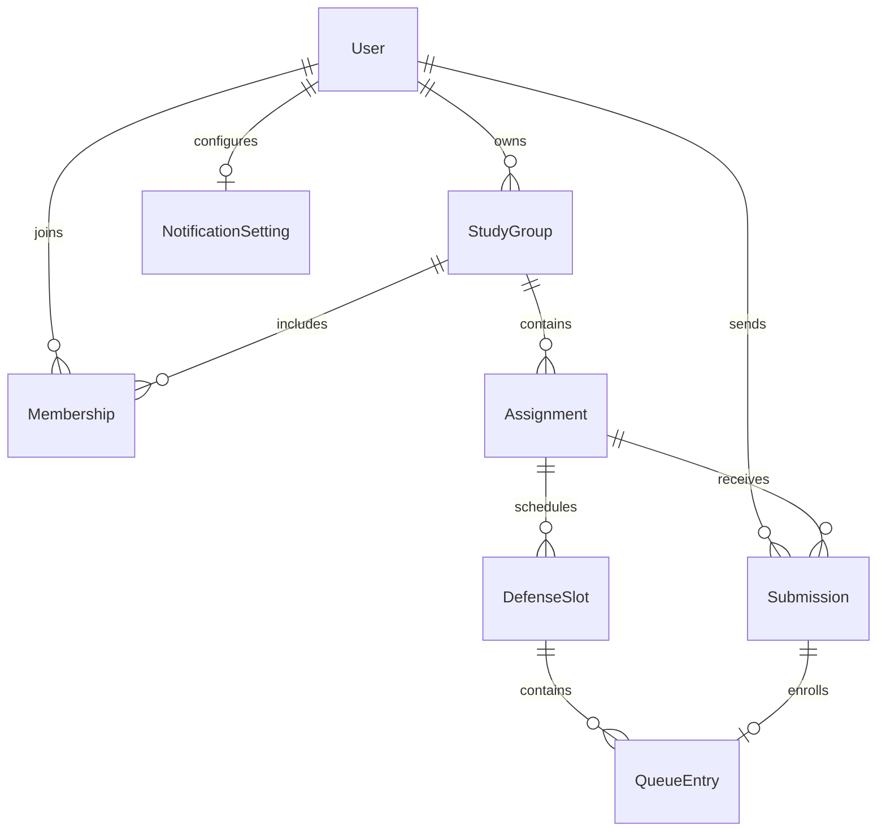

# Подключение модулей

## Что уже доступно

- `labdefender.app.create_dispatcher(session_factory, settings=settings, notifier=...)`
  подключает общий роутер (внутри — сначала меню разделов, затем регистрация),
  затем студента, преподавателя, роутер уведомлений и последним fallback. Без `settings` фабрика тоже работает, но регистрация
  по коду и админ-доступ отключены — это удобно для изолированных тестов. Без `notifier`
  уведомления отправляются сразу внутри обработчика (детерминированно для тестов);
  `run()` передаёт `Notifier(background=True, delay=0.05, webapp_url=...)`.
- Обработчики работают в личном чате. Групповые сообщения и inline-mode callbacks
  не входят в MVP.
- Mini App, этапы 0–6: `run()` при заданном `WEBAPP_URL` (или запуске с `--tunnel`)
  поднимает в том же процессе веб-сервер `labdefender.web` с общими `Notifier`
  и FSM-хранилищем бота, ставит кнопку «Приложение» и проверяет, что публичный адрес
  ведёт в этот процесс; `/start`, `/app`, помощь и уведомления дают кнопки с текущим
  адресом. В приложении есть всё, что в чате, кроме загрузки файла (она идёт через чат)
  и вступления по приглашению (ссылка `?start=join_…`). `--tunnel` поднимает временный
  или постоянный туннель Cloudflare. Контракт — раздел «Mini App».
- Аргументы обработчика `session: AsyncSession` и `current_user: User` заполняются
  middleware для сообщений и callback. Каждому update соответствует своя сессия.
- `current_user.id` — внутренний PK. `current_user.telegram_id` — ID Telegram;
  внешние ключи моделей ссылаются именно на внутренний PK.
- `RoleFilter` подключён к `message` и `callback_query` каждого ролевого роутера.
- Всё управление доступно кнопками: постоянное меню роли (`ReplyKeyboardMarkup`)
  под полем ввода и inline-кнопки под сообщениями. Каждая кнопка меню открывает тот же
  экран, что и команда; команды по-прежнему работают. Подробности — «Меню и кнопки».
- «👥 Мои группы» (`/my_groups`) работает для обеих ролей; «➕ Создать группу»
  (`/create_group`) и «🔗 Пригласить» (`/invite`) — у преподавателя.
  Общий `/start join_<token>` регистрирует участие студента, включая первый вход.
- «📝 Новое задание» (`/new_assignment`) и «📥 На проверку» (`/submissions`) работают
  у преподавателя, «📚 Задания» (`/assignments`) — у студента. Кнопки заданий, проверки
  и очереди подключены к карточкам групп.
- «🕒 Новый слот» (`/new_slot`) создаёт слот защиты для задания через мастер с кнопками
  (календарь, сетка времени, длительность, места, повтор прошлого слота) или ручной
  текстовый ввод. «🗓 Защита и очередь» (`/queue`) работает для обеих ролей, переход
  студента к записи также есть в карточке допущенного задания.
- Новая Telegram-учётка автоматически сохраняется как `student`; кнопка
  «🎓 Я преподаватель» в помощи и `/teacher` начинают проверку кода. Смена имени
  не сбрасывает роль.
- `User.full_name` — имя для показа везде. `ensure_user` обновляет его из Telegram,
  пока у пользователя нет своего имени (`UserProfile`); `services/users.py`:
  `set_display_name(session, actor_id=..., name=...)` (нормализует пробелы, 1–128
  символов, иначе `InvalidDisplayName`), `reset_display_name(..., telegram_name=...)`,
  `has_chosen_name(session, user_id=...)`. Новые экраны выводят `full_name` без
  отдельной логики имени.
- `TEACHER_REGISTRATION_CODE` задаётся в `.env`, `ADMIN_IDS` — JSON-массив Telegram ID.
  Кнопка «👤 Выдать роль преподавателя» в помощи (или `/grant_teacher` без аргумента)
  запрашивает Telegram ID, `/grant_teacher <telegram_id>` назначает роль сразу;
  пользователь должен быть зарегистрирован. Админ-права не зависят от учебной роли.
- Роли: `Role.STUDENT`, `Role.TEACHER`. Статусы: `PENDING`, `RETURNED`, `APPROVED`.
  В БД сохраняются строковые значения в нижнем регистре из общих enum-ов.
- Уведомления второй стороне подключены к сдаче, проверке, публикации, вступлению,
  созданию и повторному открытию слота, записи и смене слота. «🔔 Уведомления»
  (`/notifications`) работает для обеих ролей: преподаватель управляет категориями, студент видит,
  что его уведомления не отключаются. Контракт — в разделе «Уведомления».

## Где писать

У каждого ролевого модуля своя папка в `handlers/`. Кнопки и состояния кладём
в `keyboards/student.py`, `keyboards/teacher.py`, `states/student.py`,
`states/teacher.py` либо одноимённые подпапки по мере роста.

Общие файлы `app.py`, `config.py`, `enums.py`, `db/`, `middlewares/`,
`handlers/common.py`, `handlers/menu.py`, `handlers/registration.py`,
`handlers/notifications.py`, `keyboards/menu.py`, `services/users.py`,
`services/notifications.py`, `web/`, `tunnel.py` меняет автор ядра. Изменения схемы сначала
согласовываем: иначе разработчики получат несовместимые локальные SQLite-базы.
Остальные сервисы закрепляем за одним человеком на этапе реализации.

Ролевой модуль держит callback и шаги ввода, а **вход в раздел** (кнопка меню и её
команда) регистрируется в ядре, в `handlers/menu.py`. Пример нового файла
`handlers/student/reports.py`:

```python
from aiogram import Router
from aiogram.types import CallbackQuery, Message
from sqlalchemy.ext.asyncio import AsyncSession

from labdefender.db.models import User
from labdefender.keyboards.student import ReportCallback  # CallbackData, prefix="student"


async def show_reports(message: Message, session: AsyncSession, current_user: User) -> None:
    # Здесь вызвать общий сервис с current_user.id: он сам ограничивает доступ.
    await message.answer("Пока нет отчётов.")


def create_router() -> Router:
    router = Router(name="student_reports")

    @router.callback_query(ReportCallback.filter())
    async def report_action(callback: CallbackQuery) -> None:
        await callback.answer()

    return router
```

В `handlers/student/__init__.py` импортируем модуль и внутри `create_router()`
перед `return router` вызываем `router.include_router(reports.create_router())`.
У преподавателя — аналогично. Фабрики создают новые роутеры при каждом запуске,
что позволяет собирать Dispatcher в тестах. Не создаём второго Dispatcher или Bot
внутри модуля. Новый раздел меню согласуем с автором ядра: текст в `MenuButton`,
место в `MENU_LAYOUT`, команда в `MENU_COMMANDS` и обработчик в `handlers/menu.py`
(`entry(MenuButton.X, "command")`, `state.clear()`, вызов `show_reports`).

Сначала регистрируем точные callback, затем обработчики ввода с фильтром
конкретного FSM-состояния. Общий обработчик «любое сообщение» в ролевом модуле
перехватит команды следующих роутеров. `/start`, `/help`, `/cancel` и все входы
в разделы остаются общими: роутер меню стоит раньше ролевых, поэтому кнопка раздела
никогда не попадёт в шаг ввода модуля. Под запросом текста ставим
`reply_markup=cancel_keyboard()` из `keyboards/menu.py` — общая «Отмена», как `/cancel`.
Текст ответа после завершения диалога без inline-кнопок может нести
`main_menu(current_user.role)`, чтобы вернуть меню.
Для callback используем префиксы `student:` / `teacher:` и `CallbackData`.
На обработанную callback-кнопку всегда отвечаем через `callback.answer()`.
Префиксы `auth:` и `menu:`, FSM `TeacherRegistration` и `TeacherGrant` заняты ядром.
Код никогда не записываем в FSM и не включаем в сообщения или логи. Команды
`/teacher` и `/grant_teacher` также принадлежат ядру.

Групповые обработчики уже подключены в `handlers/student/groups.py` и
`handlers/teacher/groups.py`. Их не нужно повторно регистрировать в другом модуле.
Для будущих кнопок перехода к заданиям используйте ID группы из карточки и повторную
проверку доступа в сервисе; не храните «текущую группу» как единственный источник прав.
Пространства callback `student:groups:...`, `teacher:groups:...` (включая
`teacher:groups:create:0` — «➕ Создать группу») и `teacher:create_group:...`,
а также FSM `GroupCreation` заняты модулем групп.

## Меню и кнопки

- `keyboards/menu.py`: `MenuButton` — тексты кнопок меню; `MENU_LAYOUT[role]` — раскладка
  по ролям; `MENU_COMMANDS` — команда каждой кнопки; `main_menu(role)` — постоянная
  клавиатура (`is_persistent`, `resize_keyboard`); `menu_sections(role)` — строки
  «кнопка — команда» для помощи; `cancel_keyboard()` — общая «Отмена» (`menu:cancel`);
  `help_keyboard(role, admin=...)` — кнопки под помощью: `menu:id`, `menu:name`,
  `menu:notifications`, `auth:teacher`, «➕ Создать группу», `menu:grant`;
  `name_keyboard(chosen=...)` — «Вернуть имя из Telegram» (`menu:name_reset`) и «Отмена».
- `handlers/menu.py`: входы в разделы. Каждый обработчик ловит и команду, и текст
  кнопки (`entry`), очищает FSM и вызывает готовый `show_*`. Кнопка чужой роли
  отвечает «Этот раздел недоступен для вашей роли. Меню обновлено» и присылает
  `main_menu` текущей роли. Роутер включён в общий **до** регистрации, поэтому
  кнопка во время ввода кода не тратит попытку.
- `handlers/common.py`: `/start` и вход по приглашению присылают `main_menu`; при
  Mini App `/start` следом присылает отдельное сообщение с `app_keyboard` (у одного
  сообщения одна клавиатура, меню роли важнее);
  `/help` и «❓ Помощь» показывают пары «кнопка — команда» и `help_keyboard`, FSM
  не трогают; `/cancel` и `menu:cancel` очищают FSM и присылают меню (если ввода нет,
  кнопка отвечает «Сейчас нечего отменять»); `menu:id` и `menu:notifications`.
- `handlers/registration.py`: после успешного кода приходит меню преподавателя;
  `menu:grant` и `/grant_teacher` без аргумента ставят `TeacherGrant.waiting_for_id`;
  `/name` и `menu:name` ставят `DisplayName.waiting_for_name` (неверное имя оставляет шаг).
- Fallback отвечает на непонятный текст меню роли, на неизвестную кнопку — alert.
- Пустые списки групп — общий `answer_no_groups(message, user)` из
  `handlers/coursework.py`: преподавателю с кнопкой «➕ Создать группу».

## Mini App

Готовы этапы 0–6: каркас, задания и сдача, проверка, группы, слоты и очередь обеих
ролей, профиль, код преподавателя, выдача роли, настройки уведомлений, кнопки
приложения под уведомлениями, постоянный туннель и проверка адреса. Устройство:

- `config.Settings`: `webapp_url` (публичный `https://` без параметров и `/` в конце;
  пусто — Mini App выключена), `web_host` (`127.0.0.1`), `web_port` (`8080`),
  `webapp_auth_max_age` (секунды, по умолчанию 86400, от 60 до 7 суток),
  `tunnel_token` (`SecretStr`, токен туннеля Cloudflare с постоянным адресом; одна
  строка без пробелов; используется только с `--tunnel`).
- `web/auth.py`: `read_init_data(header, bot_token=..., max_age=...)` разбирает
  `Authorization: tma <initData>`, проверяет подпись
  (`aiogram.utils.web_app.safe_parse_webapp_init_data`), наличие `user` и возраст
  `auth_date` (допуск часов — 5 минут) и возвращает `WebAppInitData`; иначе
  `InitDataError` с текстом для пользователя.
- `web/app.py`: `create_web_app(session_factory, bot_token=..., auth_max_age=...,
  bot=..., notifier=..., storage=..., admin_ids=frozenset(), registration_code=None,
  instance=None, idempotency=None)`; `admin_ids` и `registration_code` — те же
  настройки, что у чата, `instance` — случайный ID процесса для `/health`.
  Middleware по порядку:
  `security_headers` (`nosniff`, `no-referrer`; для API — `Cache-Control: no-store`,
  для страницы — `no-cache` и CSP: скрипты свои и `telegram.org`, запросы только
  к своему адресу; `.js`/`.css` всегда с JavaScript/CSS-типом), `api_errors`
  (`DomainError` → JSON с тем же текстом, что в чате; любое другое исключение —
  в лог и 500 «Не удалось выполнить действие…», подробности наружу не уходят),
  `api_auth` (закрывает **все** `/api/…`: без проверенных данных — 401; иначе отдельная
  сессия на запрос, `ensure_user`, `request[SESSION]` и `request[USER]`).
  `/app/` — `static/index.html`, остальные файлы — из `static/`. `GET /health` без
  авторизации отвечает `{"app": "labdefender", "instance": "…"}`.
- `web/context.py`: `WebConfig` (`bot_token`, `auth_max_age`, `admin_ids`,
  `registration_code`, `instance`), ключи приложения (`SESSIONS`, `CONFIG`, `BOT`, `NOTIFIER`,
  `IDEMPOTENCY`, `STORAGE` — FSM-хранилище диспетчера), `chat_state(request, user)` —
  `FSMContext` личного чата пользователя с тем же ключом, что строит диспетчер,
  `ChatUnavailable` (бот не смог написать пользователю, 409), помощники `current_user(request)`, `db(request)`, `path_id`,
  `query_int`, `query_offset`, `read_body(request, Model, error=...)`, `page_json`
  и `error_status`: `AccessDenied` → 403, `ObjectUnavailable` → 404, ошибки ввода
  (`Invalid…`, `InvalidRequest`) → 422, `RegistrationBlocked` → 429, прочие
  доменные (конфликты состояния) → 409. Все ошибки — `{"error": "текст"}`.
- `web/idempotency.py`: `IdempotencyCache.run(user_id, key, action)` — по заголовку
  `Idempotency-Key` (8–64 символа `A-Za-z0-9_-`) 10 минут помнит **успешный** результат
  для пары «пользователь, ключ»; повтор возвращает его без нового действия и
  уведомлений, параллельный дубль ждёт первый запрос, ошибки не запоминаются.
  Хранится в памяти процесса. Страница создаёт ключ на каждый экран подтверждения.
- `web_server(session_factory, settings, bot=..., notifier=..., storage=...)` — контекст, который
  `run()` держит открытым на время polling; отдаёт `instance` процесса (без `webapp_url`
  ничего не запускает и отдаёт `None`), занятый порт даёт `LocalOperationError`.
  `configure_menu_button(bot, webapp_url)` ставит `MenuButtonWebApp` на
  `mini_app_url(webapp_url)` либо возвращает `MenuButtonDefault`.
- `web/reachability.py`: `address_check(webapp_url, instance)` — контекст рядом
  с polling: в фоне вызывает `check_public_address(<webapp_url>/health, instance)`
  (до 12 попыток через 5 секунд, сертификаты — `certifi`) и пишет в лог одно из трёх:
  адрес открывается; по адресу отвечает **другой** запуск (`instance` не совпал —
  например, не остановлен резервный ноутбук); адрес не открылся (HTTP-код или ошибка
  соединения). Бот при этом работает дальше.
- `mini_app_url(webapp_url, screen=None)` (`labdefender.web`): без экрана —
  `<webapp_url>/app/`, с экраном — `<webapp_url>/app/?screen=/review/s/42`. Экран —
  путь страницы из сегментов `/слово` или `/слово/число`, иное — `ValueError`. Экран
  идёт в query: фрагмент адреса Telegram занимает своими параметрами запуска.
- Бот: `create_dispatcher` кладёт `webapp_url` в данные обработчиков; `/app` отвечает
  `app_keyboard(webapp_url)` (inline-кнопка `web_app`), `help_keyboard(...,
  webapp_url=...)` добавляет её первой строкой, `/start` присылает её отдельным
  сообщением. `Notifier(webapp_url=...)` добавляет под уведомлениями кнопку
  «📱 Открыть в приложении» на тот же объект (раздел «Уведомления»).
- `tunnel.py`: `quick_tunnel(local_url)` запускает `cloudflared tunnel --url …`,
  читает его вывод до адреса `https://….trycloudflare.com` (30 секунд), отдаёт
  `Tunnel(url, process)` и останавливает процесс при выходе. `permanent_tunnel(token,
  url)` запускает `cloudflared tunnel run` с токеном в переменной окружения
  `TUNNEL_TOKEN` (не в командной строке) и ждёт строку `Registered tunnel connection`.
  `shared_tunnel(local_url)` — временный туннель, который держит отдельный процесс
  (`python -m labdefender.tools tunnel`, `scripts/tunnel.sh`/`.ps1`): на всё время жизни он
  держит файловую блокировку и пишет адрес в `tunnel-<local_url>.json` в той же папке
  блокировок, что и `instance_locks`; `running_tunnel(local_url)` возвращает адрес,
  только пока блокировка занята (система освобождает её при смерти процесса) и
  `local_url` совпадает. Второй хранитель того же `local_url` — `LocalOperationError`.
  Если `cloudflared` не подключился, `LocalOperationError` добавляет его последнюю
  строку `ERR` или то, что он вывел перед выходом. `python -m labdefender --tunnel`:
  при `TUNNEL_TOKEN` — постоянный туннель на `WEBAPP_URL` (без адреса — ошибка),
  иначе адрес туннеля из отдельного окна (`running_tunnel`), а без него — свой
  временный; адрес подставляется в `webapp_url` на время запуска.
- `services/slot_grid.py` — общие правила календаря и сетки (`calendar_pages`,
  `calendar_window`, `start_options`, `duration_options`, `template_fits`, подписи
  дат и длительностей). Ими пользуются и мастер слота в чате (`keyboards/slots.py`
  оставил только кнопки и кодирование callback), и API. Страница время не считает.

API (`web/api/`, все ответы JSON, списки — `{"items": [...], "offset", "has_next"}`
по 8 записей, `?offset=` для следующей страницы):

| Запрос | Ответ и проверки |
|---|---|
| `GET /api/me` | `telegram_id`, `name`, `telegram_name` (имя из подписанных данных этого запроса), `custom_name` (задано своё имя), `role`, `role_label`, `admin` (Telegram ID в `ADMIN_IDS`), `can_register` (студент и код преподавателя задан; сам код не отдаётся) |
| `PUT /api/me/name` | тело `{"name"}`; `set_display_name`; тот же объект, что `/api/me`; неверное имя — 422 |
| `DELETE /api/me/name` | `reset_display_name` с именем из Telegram; тот же объект, что `/api/me` |
| `POST /api/teacher/register` | тело `{"code"}`; `register_teacher` с теми же лимитами и счётчиком, что в чате: неверный код — 422 «Осталось попыток: N», блокировка — 429, код не задан — 409; `{"changed", "me"}`; при повышении FSM чата очищается и бот присылает в чат меню преподавателя |
| `POST /api/admin/grant` | тело `{"telegram_id": "строка цифр"}` (строка: ID может не поместиться в число JavaScript); `grant_teacher`: не администратор — 403, незарегистрированный — 409; `{"changed"}`; назначенному не пишет, как в чате |
| `GET /api/notifications` | преподавателю `categories`: `key`, `label`, `enabled`; студенту — 403 |
| `PUT /api/notifications` | тело `{"category": "submissions"\|"joins"\|"queue"\|"all", "enabled": bool}`; те же `categories`; повтор ничего не меняет |
| `GET /api/groups` | свои группы: `id`, `name` (`list_groups`) |
| `GET /api/groups/{id}/assignments` | `group` и задания: `id`, `group_id`, `title`, `format`, `format_label` |
| `GET /api/assignments/{id}/slots` | `assignment` и слоты (`list_defense_slots`; студенту — после допуска) |
| `GET /api/assignments/{id}/unassigned` | допущенные без записи: `name` (только преподаватель) |
| `GET /api/assignments/{id}/calendar?page=N` | `range_label`, `pages`, `leading` (пустые клетки до первого дня), `weekdays`, `days`: `date`, `day`, `month`, `marked`, `today` |
| `GET /api/assignments/{id}/day?date=YYYY-MM-DD` | `date_label`, `weekday`, `busy`, `starts` с `durations` (`minutes`, `end`, `label`), `template` или `null`, `capacities`; прошедшая дата — 422 |
| `POST /api/assignments/{id}/slots` | тело `{"date", "start": "HH:MM", "end", "capacity"}`, `Idempotency-Key`; 201 `{"slot"}` и уведомление допущенным без записи |
| `GET /api/slots/{id}/queue` | `assignment`, `slot` и участники: `position`, `name` |
| `POST /api/slots/{id}/close`, `…/reopen` | `{"slot"}`; `reopen` добавляет `reopened` и уведомляет только при реальном открытии |
| `DELETE /api/slots/{id}` | `{"deleted": true, "assignment_id"}`; слот с записями — 409 |
| `POST /api/groups` | тело `{"name"}`, `Idempotency-Key`; 201 `{"group"}` (только преподаватель) |
| `GET /api/groups/{id}` | `group`, `members`; преподавателю ещё `invite_link` |
| `GET /api/groups/{id}/members` | только преподаватель группы (`list_members`): `group` и студенты `name`, `username` по имени; студенту 403, чужому преподавателю 404 |
| `GET /api/groups/{id}/assignments` (студент) | у каждого задания ещё `status_label` его последней попытки |
| `POST /api/groups/{id}/assignments` | тело `{"title", "description", "format": "online"\|"in_person"}`, `Idempotency-Key`; 201 `{"assignment"}` и уведомление студентам группы |
| `GET /api/assignments/{id}` | `assignment` с `description`, `group`; студенту ещё `latest` (попытка или `null`), `status_label`, `can_submit`, `approved` |
| `GET /api/assignments/{id}/submissions` | попытки: студенту свои, преподавателю всех студентов |
| `POST /api/assignments/{id}/submissions` | тело `{"text", "expected_previous_id"}`, `Idempotency-Key`; 201 `{"submission"}` и уведомление преподавателю; текст или ссылка, как в чате |
| `POST /api/assignments/{id}/file-request` | ставит в чате шаг `SolutionSubmission.payload` (`begin_solution`) и пишет туда `solution_prompt`; дальше — обычная сдача файла в чате |
| `GET /api/submissions/{id}` | `submission` (+ `content`, `student_username`), `assignment`, `group`, `can_review` |
| `POST /api/submissions/{id}/send-file` | бот присылает файл попытки в чат того, кто нажал; без файла — 422 |
| `GET /api/review` | ожидающие проверки попытки во всех группах преподавателя (`list_pending_reviews`), сначала давние; у каждой `assignment` и `group_name` |
| `POST /api/submissions/{id}/approve`, `…/return` | `return` с телом `{"comment"}`; `{"submission"}` и уведомление студенту; повтор — 409 |
| `GET /api/assignments/{id}/booking` | после допуска: `assignment`, `booking` (`slot`, `position`, `occupied`, `entry_id`, `order_at`, `can_move`) или `null`; без допуска — 409 |
| `POST /api/assignments/{id}/enroll` | тело `{"slot_id", "expected_entry_id", "expected_order_at"}` из показанной записи; `{"booking"}`; уведомление преподавателю при реальном изменении |
| `POST /api/assignments/{id}/move-to-end` | тело `{"expected_entry_id", "expected_order_at"}`; `{"booking"}` |

Слот в ответах: `id`, `assignment_id`, `date`, `date_label`, `weekday`, `start`, `end`,
`time_label`, `capacity`, `occupied`, `is_open`, `is_past`. Попытка (`web/api/records.py`):
`id`, `assignment_id`, `attempt_number`, `status`, `status_label`, `kind`, `kind_label`,
`has_file`, `submitted_label` (Москва), `comment`, `student_name`; `file_id` наружу не
отдаётся. Операции со слотами — только преподаватель-владелец: студенту 403, чужому
преподавателю 404; чужие группы, задания и попытки — 404.

Изменяющий эндпоинт вызывает сервис **до** любых чтений в сессии запроса: сервис сам
открывает `BEGIN IMMEDIATE`, а начатое чтение мешает этому (поэтому запись на слот —
`/api/assignments/{id}/enroll` с `slot_id` в теле, принадлежность слота заданию
проверяет `enroll_slot`). Чтения для ответа — после сервиса.

Новые общие функции: `services.submissions.list_pending_reviews`,
`services.groups.count_members`, `services.groups.list_members` (страница `Page[User]`
студентов своей группы по `full_name`); в чате — `handlers.student.coursework.begin_solution`
и `solution_prompt` (их же вызывает кнопка файла в приложении).

Новый эндпоинт: модуль в `web/api/` с `routes = web.RouteTableDef()`, регистрация
в `web/api/__init__.py`. Пользователь — только `current_user(request)`, сессия —
`db(request)`; вызывается общий сервис с `user.id`, ID действующего пользователя
из тела или адреса не принимается. Уведомления — те же `notify_*` с
`request.app[NOTIFIER]` и `request.app[BOT]` после успешного сервиса. Создание
объектов оборачивается в `request.app[IDEMPOTENCY].run(...)`.

Страница — `web/static/`, без сборки (ES-модули):

- `app.js` — вход: без `initData` показывает «Откройте приложение из Telegram»,
  иначе `ready()`/`expand()`, `GET /api/me`, маршруты, запуск;
- `lib/telegram.js` — Back/Main кнопки, `showConfirm`, вибро-отклик; вне клиента
  Telegram (`platform` = `unknown`) кнопки рисуются на странице — так её можно
  проверить в обычном браузере;
- `lib/api.js` — `api(path, {method, body, key})` с `Authorization: tma …` по
  относительному пути `../api` (работает и за прокси с префиксом), `ApiError`, `newKey()`;
- `lib/router.js` — маршруты `#/…`; при запуске (во фрагменте параметры Telegram)
  открывается экран из `?screen=` (`app.js` проверяет его по шаблону) или главный,
  неизвестный путь — главный экран; устаревший асинхронный экран ничего не перерисовывает;
- `lib/dom.js` — элементы только через текстовые узлы (без `innerHTML`), списки
  с «Показать ещё», вывод ошибок (401 — «Закрыть приложение»);
- `views/common.js` — выбор группы и задания, сообщение после действия (`ctx.flash`),
  подписи слотов, многострочный текст; `views/home.js` — главный экран;
  `views/slots.js`, `views/new-slot.js` — слоты преподавателя; `views/student.js` —
  `#/tasks/…` и `#/defense/…`; `views/teacher.js` — `#/review`, `#/groups/…`, `#/work/…`;
  `views/attempt.js` — карточка попытки (`#/review/s/…`, `#/work/s/…`, `#/tasks/s/…`);
  `views/profile.js` — `#/profile` (имя, Telegram ID, вход к коду и выдаче роли),
  `#/profile/name`, `#/profile/teacher`, `#/profile/grant`, `#/notifications`;
  в `views/teacher.js` ещё `#/groups/{id}/students`.
- `lib/telegram.js` также даёт `openLink`, `share` (окно отправки `t.me/share/url`)
  и `copyText`.

Экраны для кнопок уведомлений: `/review/s/{submission}` (новое решение),
`/tasks/a/{assignment}` (новое задание, возврат), `/defense/a/{assignment}` (допуск,
новый слот), `/groups/{group}` (вступление), `/slots/s/{slot}` (запись на слот).
Переименовывая маршрут страницы, обновите и `handlers/notifications.py`.

Тесты — тестовый сервер aiohttp и `initData`, подписанные тестовым токеном
(`tests/test_web.py` — каркас, туннели, `/health` и проверка адреса,
`tests/test_web_slots.py`, `tests/test_web_coursework.py` — там кнопка файла
проверяется до сдачи файла в чате через общий диспетчер, `tests/test_web_profile.py` —
профиль, код, выдача роли, уведомления и их кнопки); проверка, что каждый относительный
`import` страницы указывает на существующий файл и экспортируемое имя.

## Готовые сервисы групп

Функции из `services/groups.py` принимают внутренний `actor_id` пользователя:

- `create_group(session, actor_id=..., name=...) → StudyGroup` — проверяет роль
  преподавателя, нормализует название, сохраняет группу и случайный уникальный токен.
- `list_groups(session, actor_id=..., offset=0) → GroupPage` — для преподавателя
  возвращает собственные группы, для студента — группы с его участием. В результате
  есть `groups`, `offset`, `has_next`; размер страницы — `GROUP_PAGE_SIZE = 8`.
- `get_group(session, actor_id=..., group_id=...) → StudyGroup` — карточка
  с проверкой владельца или членства.
- `get_invite_link(session, actor_id=..., group_id=..., bot_username=...) → str` —
  только владелец-преподаватель может получить ссылку. Handler передаёт username
  из `bot.me()`; сам сервис не обращается в Telegram.
- `parse_invite_payload(payload) → str` — проверяет формат `join_<token>` и возвращает
  токен для `join_group(session, actor_id=..., invite_token=...) → JoinGroupResult`.
  У результата есть `group` и `joined`: `True` только при создании нового участия.

`create_group` и `join_group` сами открывают транзакцию и делают commit.
Не вызывайте их после предварительного чтения в той же сессии или внутри внешнего
transaction-блока. Методы чтения commit не делают. Вступление проверяет роль,
токен и наличие участия под одной SQLite-блокировкой; параллельные запросы
не создают второе участие.

Создание группы через интерфейс защищено от повторного подтверждения: FSM хранит
имя и случайный идентификатор текущего черновика, callback должен соответствовать
ему. После commit FSM очищается до отправки сообщений. Старая кнопка, потеря
черновика при рестарте или ошибка доставки не запускают создание повторно.
Отдельный новый вызов `create_group` создаёт новую группу: одинаковые названия
разрешены, сервис сам по себе не объединяет такие группы.

## Транзакции и права

Сервис выполняет проверку прав и состояния объекта, запись и явный `commit`;
при ошибке — `rollback`. Handler отправляет сообщение об успехе после возврата
сервиса. Middleware закрывает сессию; несохранённые изменения откатываются,
автоматического commit в конце обработчика нет.

`ensure_user` сохраняет профиль отдельно **до** ролевого обработчика; поэтому
транзакция бизнес-операции не захватывает обновление Telegram-профиля. Чтение через
SQLAlchemy само начинает транзакцию: не вызываем `session.begin()` после такого
чтения без завершения предыдущей. В критичных операциях очередь сначала берёт
блокировку, затем проверяет состояние и свободные места; реализация — этап 5.

Успешный `RoleFilter` проверяет только роль. Сервис обязан проверять владельца
группы/попытки, участие в группе и принадлежность слота заданию. Существование ID
в callback, FSM или БД само по себе прав не даёт.

Готовые проверки из `services/access.py`:

- `require_user(session, actor_id=..., role=...)` — пользователь и необязательная роль.
- `require_group_owner(session, actor_id=..., group_id=...)` — преподаватель-владелец.
- `require_group_member(session, actor_id=..., group_id=...)` — студент-участник.
- `require_assignment_access(session, actor_id=..., assignment_id=...)` — доступ
  владельца группы или её студента к заданию.
- `require_submission_access(session, actor_id=..., submission_id=...)` — преподаватель
  своей группы или автор решения, который всё ещё состоит в группе.
- `require_defense_slot_access(session, actor_id=..., slot_id=...)` — доступ
  к дню через его задание. Допуск к записи и вместимость эта проверка не проверяет.

Функции возвращают разрешённую ORM-модель или выбрасывают безопасную `DomainError`.
Они не делают commit. Отсутствующий и чужой объект получают одинаковый ответ.
Middleware показывает доменные ошибки по-русски; для callback — через alert.
Не отправляйте файл/содержимое попытки до успешного вызова проверки.

`db.transactions.immediate_transaction(session)` открывает `BEGIN IMMEDIATE`:
при успешном выходе делает commit, при исключении — rollback. Вызов должен быть
**до любых запросов** в этой сессии: проверки доступа выполняются уже внутри него.
Именно так операции регистрации и ручного назначения сериализуют проверки и запись.
Для будущих сервисов, которым нужна такая блокировка:

```python
async with immediate_transaction(session):
    group = await require_group_owner(session, actor_id=actor_id, group_id=group_id)
    # Проверить входные данные и изменить разрешённый объект.
# Успех сообщаем только после выхода из блока.
```

Ошибка неверного кода — особый случай: счётчик сначала коммитится, затем сервис
выбрасывает `InvalidRegistrationCode` или `RegistrationBlocked`. Не оборачивайте
`register_teacher` и `grant_teacher` во внешнюю транзакцию. События одного пользователя
в диалогах сериализованы `SimpleEventIsolation`; лимит попыток дополнительно
защищён SQLite-блокировкой и работает между отдельными сессиями.

## Задания и попытки: готовый контракт

Обработчики находятся в `handlers/student/coursework.py` и
`handlers/teacher/coursework.py`. Общий показ карточек и длинного текста —
`handlers/coursework.py`, кнопки — `keyboards/coursework.py`. Зарезервированы callback
`student:course:...`, `teacher:course:...`, `student:submit:...`, `teacher:publish:...`
и FSM `AssignmentCreation`, `SolutionSubmission`, `SubmissionReview`.
Не регистрируйте эти команды и callback повторно в других роутерах.

Из `services/assignments.py` доступны:

- `create_assignment(session, actor_id=..., group_id=..., title=..., description=...)`
  возвращает `Assignment`. Проверяет владельца, название и условие, сохраняет публикацию.
- `get_assignment(session, actor_id=..., assignment_id=...)` возвращает разрешённый объект.
- `list_assignments(session, actor_id=..., group_id=..., offset=0)` возвращает `Page[Assignment]`.

Из `services/submissions.py` доступны:

- `text_solution(text)` и `document_solution(file_id=..., file_name=..., file_size=...,
  mime_type=...)` возвращают проверенный `Solution`. Данные файла берём из Telegram;
  неизвестный размер, лишний тип, противоречивый MIME или превышение 20 МиБ отклоняются.
- `submit_solution(session, actor_id=..., assignment_id=..., expected_previous_id=...,
  solution=...)` возвращает сохранённую `Submission`. `expected_previous_id` — ID
  последней попытки на момент начала диалога, либо `None`, если её ещё не было.
  Сервис заново проверяет payload, членство, последнюю попытку и её статус под
  одной SQLite-блокировкой. При изменении предыдущей попытки черновик считается устаревшим.
- `latest_submission(session, actor_id=..., assignment_id=...)` возвращает последнюю
  собственную попытку студента или `None`.
- `get_submission(session, actor_id=..., submission_id=...)` возвращает
  `SubmissionDetail` с полями `submission`, `student`, `assignment`, `group`.
  Проверяет доступ **до** выдачи содержимого. Студент из той же группы не видит чужую работу.
- `list_submissions(session, actor_id=..., assignment_id=..., offset=0)` возвращает
  `Page[SubmissionItem]`. Элемент содержит `submission` и `student_name`.
  Для преподавателя это все попытки задания его группы, для студента — только собственные.
  Сортировка — от новых к старым, история возвратов сохраняется.
- `require_reviewable(session, actor_id=..., submission_id=...)` проверяет право
  преподавателя и актуальное `pending`-состояние перед началом диалога комментария.
- `review_submission(session, actor_id=..., submission_id=..., decision=...,
  comment=None)` возвращает `Submission`. Разрешены только `APPROVED` и `RETURNED`.
  Возврат требует комментарий. При допуске сохраняется UTC-время `approved_at`.

`create_assignment`, `submit_solution`, `review_submission` сами открывают
`immediate_transaction` и коммитят изменения. Вызывайте их в новой сессии update
до запросов чтения и не оборачивайте во внешнюю транзакцию. Методы чтения и
`require_reviewable` не коммитят. Проверку, выполненную при начале диалога, сервис
записи повторяет: это защищает от устаревших кнопок и гонок.

Повторная сдача допускается только после `RETURNED`; новая попытка получает следующий
номер. При `PENDING` или `APPROVED` отправка отклоняется. Переходы проверки возможны
только у последней `PENDING`-попытки. Повторное решение вызывает `SubmissionConflict`,
не меняет комментарий и время допуска. Ошибки домена обрабатываются общим middleware.

`Page` содержит `items`, `offset`, `has_next`; общий размер страницы — 8.
Файловые метаданные используются для проверки и предпросмотра в FSM, в таблице
попытки сохраняется только `file_id`. Для текста и ссылки сохраняется `content`.
`send_text` делит длинные сообщения по UTF-16 без потери содержимого и отключает
предпросмотр ссылок. `PlainTextInput` различает команды по Telegram entities,
поэтому текст решения с `//` в начале принимается как текст.

## Слоты защиты и очередь: готовый контракт

Ролевые обработчики — `handlers/student/defense.py`, `handlers/teacher/defense.py`,
мастер создания слота — `handlers/teacher/slots.py`, общий показ — `handlers/defense.py`.
Callback находятся в `keyboards/defense.py`: `student:queue:...`, `teacher:queue:...`,
`student:queue_confirm:...`, `teacher:day_confirm:...`; кнопки мастера —
в `keyboards/slots.py`: `teacher:slot:<action>:<value>:<nonce>`. FSM `DefenseSlotCreation`
и `QueueChange` хранят только черновик и снимок своей записи для подтверждения.

### Мастер слота

`start_slot_wizard(message, session, user, state, assignment_id=...)` проверяет роль
и владельца задания, затем открывает календарь. Шаги — состояния `DefenseSlotCreation`:
`date → start_time → end_time → capacity → confirmation`. На каждом шаге
принимается и кнопка, и текст (`YYYY-MM-DD`, `HH:MM`, число), поэтому пресеты
необязательны. При входе в шаг черновик теряет значения следующих шагов и получает
новый `nonce`: кнопки предыдущих шагов, других черновиков и повторные нажатия
отвечают «Кнопка устарела». Нажатие кнопки редактирует сообщение мастера
(`edit_text`); если Telegram отказал, шаг приходит новым сообщением. После текстового
ввода следующий шаг всегда отправляется новым сообщением. Кнопки `noop` (дни недели,
пустые клетки) только отвечают на callback.

`value` в callback — номер страницы календаря, дата `YYYYMMDD`, минуты от полуночи,
длительность, число мест или ID слота-шаблона. Это лишь указатель: дата и время заново
проверяются `validate_defense_slot`, шаблон — через `require_defense_slot_access`,
а запись, пересечения и прошедшее время — в `create_defense_slot` при подтверждении.
Сетка и пресеты — константы `keyboards/slots.py`; функции `start_options`,
`duration_options`, `template_fits` и сборщики клавиатур чистые и не обращаются к БД.
Страницы календаря строит `calendar_pages(today)`: три строки-недели, точки в начале
(дни недели до первой даты) повторяются в конце, но не меньше 14 дат; каждая страница
начинается со дня после предыдущей, последняя — не позже чем через 365 дней.
`calendar_window(today, page)` возвращает границы страницы или `ValueError`,
который мастер показывает как устаревшую кнопку.
Callback мастера, включая ID шаблона до `2**63 − 1`, укладываются в 64 байта.

Все операции используют общий `services/queue.py`:

- `create_defense_slot(session, actor_id=..., assignment_id=..., day_date=...,
  start_time=..., end_time=..., capacity=...)`
  возвращает `DefenseSlot`; проверяет роль преподавателя, владельца, дату и время
  по Москве, `start_time < end_time` и положительный целый лимит. Пара
  «задание + дата + начало» уникальна, пересекающиеся слоты задания отклоняются.
  Повтор тех же параметров безопасен; изменение лимита существующего слота отклоняется.
- `list_slots_between(session, actor_id=..., assignment_id=..., first_day=..., last_day=...)`
  возвращает кортеж `DefenseSlot` задания за период включительно, по дате и началу.
  Только для преподавателя-владельца; нужен мастеру для отметок и скрытия занятого времени.
- `latest_slot_template(session, actor_id=..., assignment_id=...)` возвращает последний
  созданный слот преподавателя с приоритетом: это задание, затем его группа, затем любой
  свой слот. `None`, если слотов нет. Используется кнопкой «Как в прошлый раз».
- `require_approved(session, actor_id=..., assignment_id=...)` возвращает последнюю
  собственную `APPROVED`-попытку студента с `approved_at` или выбрасывает ошибку.
- `list_defense_slots(session, actor_id=..., assignment_id=..., offset=0)` возвращает
  `Page[SlotItem]`; у элемента есть `slot` и `occupied`. Студенту нужны допуск и
  участие в группе; ему показываются только актуальные и будущие слоты.
  Преподаватель своей группы видит и прошлые слоты.
- `get_defense_slot(session, actor_id=..., slot_id=...)` возвращает `SlotItem`
  с проверкой доступа к заданию. Сам по себе этот метод не разрешает запись:
  допуск, время и флаг `is_open` повторно проверяет сервис изменения очереди.
- `get_student_booking(session, actor_id=..., assignment_id=...)` возвращает
  `StudentBooking` (`entry`, `slot`, `position`, `occupied`) либо `None`.
  Доступна только собственная запись студента.
- `get_slot_queue(session, actor_id=..., slot_id=..., offset=0)` возвращает
  `SlotQueue` (`slot`, `occupied`, `members`). `members` — `Page[QueueMember]`,
  элементы содержат `entry_id`, `submission_id`, `student_name`, `position`.
  Это преподавательский метод; чужие группы и студенты к списку имён не допускаются.
- `enroll_slot(session, actor_id=..., assignment_id=..., slot_id=...,
  expected_entry_id=..., expected_order_at=...)` создаёт или перемещает одну запись
  и возвращает `QueueEntry`. Для первой записи передайте `None, None`.
  Для смены слота — ID и UTC-время `order_at` из предыдущего `StudentBooking.entry`.
- `move_to_end(session, actor_id=..., assignment_id=..., expected_entry_id=...,
  expected_order_at=...)` переносит собственную запись в конец выбранного слота
  и возвращает `QueueEntry`. Последняя запись остаётся без изменения порядка.
- `close_defense_slot(session, actor_id=..., slot_id=...)` закрывает слот для новых
  записей и возвращает `DefenseSlot`. `reopen_defense_slot(...)` открывает будущий слот
  и возвращает `ReopenSlotResult` (`slot`, `reopened`); `reopened` — `False`, если слот
  уже был открыт и ничего не изменилось. `cancel_defense_slot(...)` удаляет только пустой слот.
- `approved_unassigned_query(assignment_id, *columns)` — общий запрос «последняя
  попытка допущена, записи нет»; права не проверяет. Его используют
  `list_approved_unassigned` и выбор получателей уведомления о новом слоте.

`create_defense_slot`, `enroll_slot` и `move_to_end` сами открывают
`immediate_transaction`; вызывайте их до любого чтения в свежей сессии update.
Проверки прав, актуальной попытки, прежней записи, принадлежности слота заданию,
времени, вместимости и запись проходят под одной SQLite-блокировкой. При неудачной
смене слота rollback сохраняет прежнее место. Повторная запись в текущий слот
возвращает существующую запись, сохраняя порядок даже при заполненном дне.

Порядок один для двух интерфейсов: `(QueueEntry.order_at, QueueEntry.id)`.
Первая запись получает `approved_at` попытки. Перенос в конец и смена слота получают
ключ `max(UTC now, хвост + 1 микросекунда)`, поэтому совпадение часов не ставит
перенесённого студента перед хвостом. Позиция вычисляется оконной функцией,
не хранится в FSM или отдельном столбце. При поздней записи ранее допущенного
студента позиции уже записавшихся могут измениться.

Перед изменением сравниваются ID и `order_at` предыдущей записи. При устаревшем
снимке выбрасывается `QueueChanged`. Интерфейс дополнительно связывает подтверждение
со случайным `nonce` текущего черновика и очищает FSM до Telegram-вызовов после
commit: повтор доставки кнопки не переносит запись снова. Саму запись и очередь
всегда читаем из БД. `approved_at` при переносах не изменяется.

Календарная дата берётся через `ZoneInfo("Europe/Moscow")`; зависимость `tzdata`
нужна для систем без IANA-базы. Серверные моменты событий остаются UTC без offset.
Создание слота и изменения проверяют актуальные дату и время после получения блокировки.
Схема таблиц обновлена: добавлены формат задания и слоты защиты.

## Уведомления: готовый контракт

Доставка, тексты и экран настроек `show_notification_settings(message, session, user)`
— в `handlers/notifications.py`; вход в экран («🔔 Уведомления», `/notifications`,
`menu:notifications`) — в `handlers/menu.py` и `handlers/common.py`; кнопки и тексты
настроек — в `keyboards/notifications.py`. Зарезервированы команда `/notifications`
и callback `teacher:notify:<category>:<enabled>:<source>`, где `category` —
`submissions`, `joins`, `queue` или `all`, `source` — `notice` (кнопка «🔕» под
уведомлением, ответ alert-ом) или `settings` (экран настроек, сообщение
редактируется). Роутер уведомлений (только переключатели) подключён после ролевых
и без `RoleFilter`: право менять настройки проверяет сервис.

`Notifier` передаётся в обработчики аргументом `notifier`, бот — аргументом `bot`.
Готовые функции вызываются **после** успешного сервиса и `state.clear()`, но **до**
ответа автору действия, чтобы сбой этого ответа не терял уведомление:

- `notify_submission_received(notifier, bot, session, submission_id=...)` —
  преподавателю группы, категория `submissions`;
- `notify_submission_reviewed(..., submission_id=...)` — автору о допуске или возврате;
- `notify_assignment_published(..., assignment_id=...)` — всем студентам группы;
- `notify_slot_opened(..., slot_id=..., reopened=False)` — допущенным без записи,
  только для открытого будущего слота с местами;
- `notify_student_joined(..., group_id=..., student_id=...)` — преподавателю,
  категория `joins`; вызывать только при `JoinGroupResult.joined`;
- `notify_queue_booking(..., entry_id=..., switched=...)` — преподавателю, категория
  `queue`; вызывать только если `enroll_slot` действительно изменил запись.

Каждая функция сама ловит и логирует любые ошибки: после commit уведомление не может
превратить успешное действие в ошибку. Тексты собираются из БД заново; права получателя
проверяются при нажатии кнопки обычными сервисами. `Notifier(background=False)`
доставляет сразу, `background=True` ставит рассылку фоновой задачей, `delay` — пауза
между сообщениями. `wait_idle()` ждёт фоновых задач (для тестов), `close()`
вызывается при остановке и ждёт до 10 секунд. Длинный текст делится `split_text`
(как `send_text`), кнопки — у последней части. `TelegramRetryAfter` повторяется
один раз после паузы; прочие ошибки Telegram только логируются.

`Notifier(webapp_url=...)` (`run()` передаёт адрес Mini App) добавляет под каждым
уведомлением `web_app`-кнопку «📱 Открыть в приложении» на экран того же объекта:
`notifier.app_url(screen)` → `mini_app_url(webapp_url, screen)` или `None` без Mini App.
Раскладка `notice_keyboard(buttons, app=..., mute=...)`: кнопки чата, затем приложение,
затем «🔕». Кнопка хранит адрес на момент отправки: после перезапуска с временным
туннелем она в старых уведомлениях не работает, с постоянным адресом — работает.
Настройки категорий в приложении (`GET/PUT /api/notifications`) вызывают те же
`get_notification_preferences` и `set_notification_preferences`.

Из `services/notifications.py` доступны:

- `NoticeCategory` (`SUBMISSIONS`, `JOINS`, `QUEUE`) и `NotificationPreferences`
  с методом `enabled(category)`;
- `get_notification_preferences(session, actor_id=...)` и
  `set_notification_preferences(session, actor_id=..., categories=..., enabled=...)` —
  только для преподавателя, собственные настройки; запись открывает
  `immediate_transaction` и идемпотентна;
- `teacher_preferences`, `submission_context`, `slot_context`, `group_students`,
  `approved_unbooked_students` — чтения для подготовки уведомления. Права не проверяют:
  вызываются только после авторизованного и сохранённого действия.

## Общая схема после добавления форматов и слотов

Модели импортируются из `labdefender.db.models`. Таблицы создаются при запуске.

- `User`: внутренний `id`, уникальный `telegram_id`, необязательный `username`,
  `full_name`, `role`, `created_at`.
- `StudyGroup`: `id`, `teacher_id`, `name`, уникальный случайный `invite_token`.
- `Membership`: составной первичный ключ `(group_id, student_id)`.
- `Assignment`: `id`, `group_id`, `title`, `description`, `format` (`online` / `in_person`).
- `Submission`: `id`, `assignment_id`, `student_id`, `attempt_number`, `kind`,
  `status`, `content` или `file_id`, `review_comment`, `submitted_at`, `approved_at`.
  Номер попытки положителен и уникален внутри задания и студента. Возврат требует
  комментария, допуск — времени; CHECK-ограничения проверяют тип полезной нагрузки.
- `DefenseSlot`: `id`, `assignment_id`, `date`, `start_time`, `end_time`,
  положительный `capacity`, `is_open`; уникальна тройка `(assignment_id, date, start_time)`.
- `QueueEntry`: `id`, `slot_id`, уникальный `submission_id`, `order_at`.
- `TeacherRegistrationAttempt`: `user_id` как PK/FK, `failed_attempts`,
  `window_started_at`. Хранит только счётчик и начало окна, не код.
- `NotificationSetting`: `user_id` как PK/FK, флаги `submissions`, `joins`, `queue`.
  Строка появляется при первом изменении настроек; без строки всё включено.
  Таблица `notification_settings` создаётся `create_all`, миграция не нужна.
- `UserProfile` (`user_profiles`): `user_id` как PK/FK, `display_name` до 128 символов —
  имя, выбранное пользователем. Пока строка есть, `ensure_user` не перезаписывает
  `User.full_name` из Telegram (подзапрос в upsert). Тоже добавочная таблица.
  `check_database` перечисляет такие добавочные таблицы в `ADDITIVE_TABLES`:
  их отсутствие не мешает `backup`/`restore`, `doctor` сообщает, что они будут созданы.

Foreign key включены на каждом SQLite-соединении. Удаления пока не поддерживаем;
каскадного удаления учебных данных нет. Даты дней защиты — календарные даты;
моменты событий — UTC без offset, как их хранит SQLite. Для записи времени из
Python используем `datetime.now(UTC).replace(tzinfo=None)`, для показа конвертируем
UTC в `Europe/Moscow`.

**Что схема сама не гарантирует:** роль владельца группы, членство автора решения,
переходы статусов, единственную актуальную попытку, соответствие задания у слота
и попытки, вместимость и одну активную запись студента на задание. Это обязательные
проверки общих сервисов в транзакции, а не уже готовые возможности каркаса.



## Готовность общих сервисов

Уже реализованы `services.users.ensure_user`, `services.auth.register_teacher`,
`services.auth.grant_teacher`, проверки `services.access`, сервисы заданий
и попыток. Функции регистрации
возвращают `True` при смене роли, `False`, если она уже выдана, либо доменную ошибку.
Они принимают внутренний `actor_id`; `grant_teacher` дополнительно получает
`target_telegram_id` и `admin_ids` из настроек. Также готовы `services.groups`,
`services.queue`, `services.notifications` с `handlers.notifications`, меню ролей
с кнопками (`keyboards.menu`, `handlers.menu`), каркас Mini App (`web`, `tunnel`)
и описанные выше ролевые обработчики. Локальный запуск, резервирование, backup/restore и команда
`migrate` также готовы.

Все функции получают `session` и ID действующего пользователя; идентификаторы
объектов передаём явно. Сервисы не зависят от `Message`, `CallbackQuery` и FSM.
Лимит файла — в общем сервисе, повторная проверка перед записью обязательна.

## Проверка перед интеграцией

Из корня репозитория после установки dev-зависимостей:

```powershell
python -m pytest -q
python -m ruff check .
python -m ruff format --check .
```

Тесты не используют настоящий токен и не обращаются в Telegram. Для ручного
smoke-теста нужен свой бот из BotFather; не запускаем один токен одновременно
на нескольких компьютерах.
